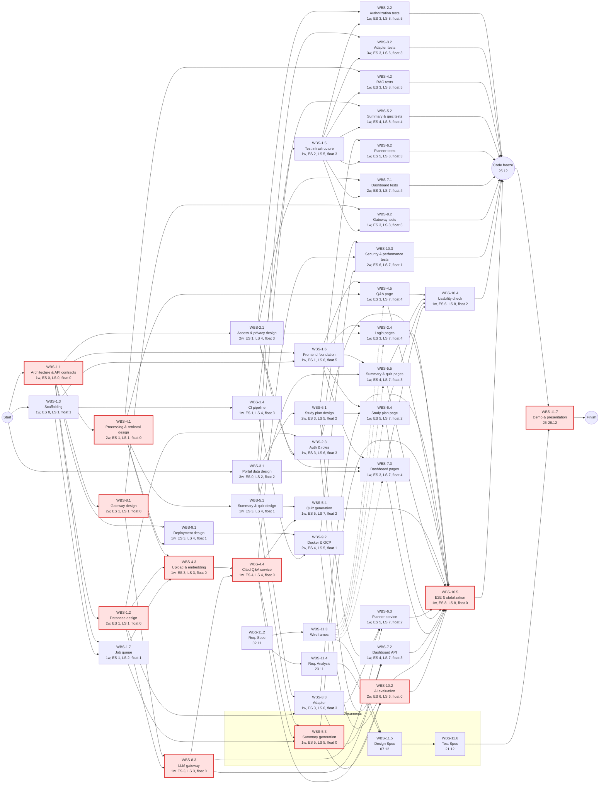
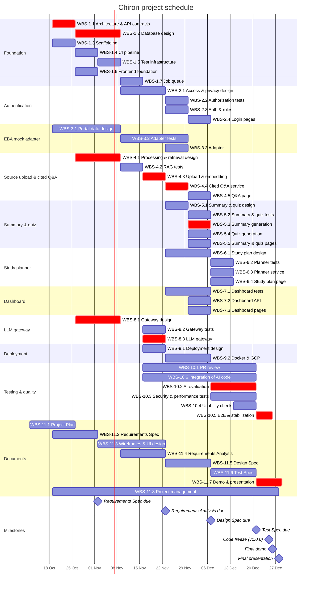

# Software Engineering — Project Plan

## Cover Page

| Field | Details |
|---|---|
| **Course** | BLG 411E Software Engineering |
| **Report name** | Project Plan |
| **Project title** | Chiron |
| **Group name / number** | Forge of Hephaistos |
| **Group members** | Burak Emre Polat — 150230328, Metin Furkan Amarat — 150230301, Hasan Yalçın Arıkanoğlu — 150220341, Berkay Türk — 150220320, Abdullah Faruk Özbek — 150220327 |
| **Instructor** | Prof. Dr. Tolga Ovatman, Assoc. Prof. Dr. Ayşe Tosun |
| **Submission date** | 2026-10-25 |
| **Document version** | 1.0 |

---

## 1. Introduction

### 1.1 Scope

**Project overview:**
Students using online education portals such as EBA have course material spread across many sources and little guidance on what to study next. Chiron is an AI-powered study assistant for EBA-like portals. Students upload course sources, ask questions answered with citations to those sources, generate summaries (as PDF) and quizzes from them, and get a weekly study plan that sets study hours and steps for their weakest topics. Teachers and administrators follow the performance and AI token usage of the students assigned to them. Portal integration is demonstrated with a mock EBA adapter. The scope below follows the approved Project Charter and the requests of Customer Meeting 1 (14.10.2026).

**In scope:** (all Must-have in the charter)
- Authentication and role-based access for students, teachers and administrators
- EBA mock adapter serving courses, units, topics, content and student grades
- Source upload and question answering with citations (RAG)
- Summary generation as PDF (LaTeX) and quiz generation from the selected sources
- Weekly study planner for the weakest topics, with study hours and steps per topic
- Teacher/admin dashboard for student performance and token usage
- Multi-model LLM gateway with fallback, cost control and per-student token tracking
- Cloud deployment on GCP with CI/CD

**Optional scope:**
- Additional study material formats such as flashcards (Stretch in the charter; only if the output proves reliable)
- Mobile-friendly web interface, to be decided in a later customer meeting (issue #4)

**Out of scope:**
- Real integration with the official EBA platform
- Multimodal output generation: short-form video, audio overviews and PPTX presentations
- Native mobile applications
- Training or fine-tuning of custom models
- Languages other than Turkish and English

**Assumptions and constraints:**
- **Time:** development runs from 19.10.2026 to the code freeze on 25.12.2026 (10 weeks); demo on 26.12.2026, presentation on 28.12.2026. The Project Plan deadline was moved from 19.10 to 25.10.2026; the other document deadlines follow the charter.
- **Team:** 5 members, each available for about 0.4 FTE (around 16 hours per week) next to other courses; the project manager spends an extra 0.05 FTE (about 2 hours per week) on project management.
- **AI agent:** the AI agent (Claude Code), listed as a team member in the charter, drafts code, tests and documents through branches and PRs; every output is reviewed by a team member. We assume the AI agent drafts 80% of the coding effort, 40% of the test-writing effort and 30% of the course reports; this work does not use team capacity. Reviewing every AI-drafted PR (WBS-10.1) and completing and integrating the AI's code (WBS-10.6) are planned as separate team activities. We will track the real shares in the AI usage reports and update the plan if they turn out different.
- **Process:** for each feature we first design it, then write the tests, then build it (test-first). Following the effort split from the course, most of our effort goes into analysis, design and testing (Section 3).
- **Budget:** GCP services stay within free-tier / student credits. LLM calls use the providers' free tiers and student credits first; paid LLM API usage is capped at $20 per month for the whole team, enforced and tracked per student by the gateway. Tests use mocked LLM calls and cost nothing.
- **Technology:** as listed in the charter (FastAPI, PostgreSQL with pgvector, Redis job queue, React, LiteLLM, bge-m3, Tectonic, GCP).

### 1.2 Deliverables

| Deliverable ID | Deliverable name | Description / contents | Acceptance criterion |
|---|---|---|---|
| D-01 | Backend services | FastAPI REST services for authentication, the EBA mock adapter, sources, generation jobs, the study planner and the dashboard, with the PostgreSQL schema and the job queue | All endpoints match the OpenAPI contracts and pass their unit and integration tests in CI |
| D-02 | AI pipeline | Document processing and embedding, retrieval with citations, LLM gateway, summary, quiz and study plan generation | Passes mocked-LLM tests; on the evaluation set at least 80% of answers cite a correct source passage and at least 95% of generated summaries compile to PDF |
| D-03 | Web frontend | React application in Turkish with student, teacher and administrator views | All main user flows pass the Playwright end-to-end tests; SUS score of at least 70 |
| D-04 | Deployed system and CI/CD | Docker images, GCP deployment (Cloud Run, Cloud SQL, Cloud Storage) and GitHub Actions pipelines | `main` is deployed automatically; release v1.0.0 runs on GCP |
| D-05 | Test suite and evaluation dataset | Unit, integration, end-to-end, security and performance tests; mocked LLM fixtures; Turkish/English evaluation questions | At least 80% backend test coverage (course standard); all tests pass on v1.0.0 |
| D-06 | Documentation | Course reports, README, `agents.md`, API documentation and AI usage reports | Each report is released on GitHub by its deadline and reviewed by the TA |
| D-07 | Demo and final presentation | Demo of v1.0.0 and the final presentation | Demo runs from v1.0.0 on 26.12.2026; presentation given on 28.12.2026 |

### 1.3 Functional Requirements / Tasks

Tasks T-02 to T-09 are the in-scope epics of the charter, in the same order. T-01, T-10 and T-11 hold the work that all epics need.

| Task ID | Functional requirement / task | Description | Related deliverable ID(s) |
|---|---|---|---|
| T-01 | Foundation and architecture | Architecture and API contracts, database, repository, CI, test infrastructure, frontend foundation and job queue that all features build on | D-01, D-03, D-04, D-05 |
| T-02 | Authentication & Authorization | Users register and log in; access is limited by role (student, teacher, administrator) and by student assignments | D-01, D-03, D-05 |
| T-03 | EBA Mock Adapter | The system reads courses, units, topics, content and per-topic student grades from a mock EBA portal through a replaceable adapter | D-01, D-05 |
| T-04 | Source Upload & Cited RAG Q&A | Students upload documents; the system parses and embeds them and answers questions with citations to the source passages | D-01, D-02, D-03, D-05 |
| T-05 | Summary & Quiz Generation | The system generates summaries of the selected sources as PDF (LaTeX) and quiz-style questions grounded in the same passages | D-02, D-03, D-05 |
| T-06 | Weekly Study Planner | The system computes per-topic success rates from portal grades and generates a weekly plan with study hours and steps for the weakest topics | D-01, D-02, D-03, D-05 |
| T-07 | Teacher/Admin Dashboard | Teachers see their students' performance in their subject; administrators see all subjects; both see token usage | D-01, D-03, D-05 |
| T-08 | Multi-model LLM Gateway | All LLM calls go through one layer with several providers, fallback, cost control and per-student token tracking | D-02, D-05 |
| T-09 | Cloud Deployment & CI/CD | The system runs on GCP and is built, tested and deployed automatically | D-04 |
| T-10 | Testing and quality | Review of AI-drafted code, AI evaluation, security, performance, usability and end-to-end tests | D-05 |
| T-11 | Documentation and project management | Course reports, customer meetings, request tracking, demo and presentation | D-06, D-07 |

### 1.4 Non-functional Issues

| Quality attribute | Requirement / concern | How it will be assessed |
|---|---|---|
| Security and privacy | Passwords are hashed; JWT sessions; every endpoint checks role and assignment; only the data the features need is stored and students' personal data is handled according to KVKK (no real student data in development); API keys kept in secrets; uploaded documents are treated as untrusted input (prompt-injection defense) | Authorization tests for each role including cross-user access (WBS-2.2, WBS-7.1); privacy and prompt-injection tests (WBS-10.3) |
| Performance | Normal API calls answer within about 1 second with 20 users at the same time; a cited answer starts within 10 seconds; summary and quiz jobs show their status and finish within 2 minutes | Simple load test on the deployed system (WBS-10.3) |
| Usability | Turkish interface; generated answers and study material are in Turkish; clear navigation for each role; System Usability Scale (SUS) score of at least 70 | Usability sessions with at least 5 students and the SUS questionnaire (WBS-10.4) |
| Accessibility | Keyboard navigation, sufficient contrast, labels and alternative texts (WCAG 2.1 AA basics) | Lighthouse accessibility score of at least 90 on every page and a keyboard-only walkthrough of the main flows (WBS-10.4) |
| Reliability | If an LLM provider returns an error, rate-limits or times out, the gateway retries and falls back to another provider; a generation job that fails (e.g. LaTeX does not compile, invalid output, all providers unavailable) or runs longer than 2 minutes is marked as failed and the user sees an error message | Provider-failure and job-failure tests (WBS-8.2, WBS-5.2) |
| Cost | Token usage recorded per student; monthly budget limit enforced | Budget limit tests (WBS-8.2); token usage on the dashboard |
| Maintainability | At least 80% backend test coverage (course standard); linters; every change reviewed in a PR | Coverage and lint checks in CI (WBS-1.4, WBS-1.5); PR review (WBS-10.1) |

---

## 2. Project Plan — Work Breakdown Structure (WBS)

**T = Tiny · S = Small · M = Medium · L = Large · XL = Extra-large**

| WBS activity ID | Parent task ID | Activity / subtask | Description / completion condition | Size (T/S/M/L/XL) |
|---|---|---|---|---|
| WBS-1.1 | T-01 | Architecture and API contracts | Services, data flow and REST API contracts (OpenAPI) agreed by the team; every build activity starts from them | M |
| WBS-1.2 | T-01 | Database design and migrations | Tables for users, roles, assignments, courses, topics, grades, sources, generated material, plans and token usage; Alembic migrations | S |
| WBS-1.3 | T-01 | Repository scaffolding | Backend and frontend skeleton, linters, README, `agents.md`; the project builds and runs locally | T |
| WBS-1.4 | T-01 | CI pipeline | GitHub Actions runs linters and tests on every PR; branch protection on `main` | T |
| WBS-1.5 | T-01 | Test infrastructure | pytest and Vitest setup, mocked LLM and provider fixtures, coverage report in CI | S |
| WBS-1.6 | T-01 | Frontend foundation | App shell, routing, API client generated from the contracts, Turkish interface texts, accessible shared components | S |
| WBS-1.7 | T-01 | Background job queue | Redis and a worker for long-running generation, job status API, time limits and failure states | S |
| WBS-2.1 | T-02 | Access and privacy design | Role and assignment access matrix; which personal data is stored and how (KVKK) | S |
| WBS-2.2 | T-02 | Authorization tests | Tests for each role, including attempts to access other users' data | S |
| WBS-2.3 | T-02 | Authentication and role-based access | Register/login, password hashing, JWT, role checks and student assignments | S |
| WBS-2.4 | T-02 | Login and account pages | Registration, login and account pages for all roles | T |
| WBS-3.1 | T-03 | Portal data design and mock data | Data model for courses, units, topics, content and per-topic grades; realistic and consistent sample data | S |
| WBS-3.2 | T-03 | Adapter tests | Contract tests for the adapter interface | T |
| WBS-3.3 | T-03 | Adapter | Backend reads the mock portal data through an adapter interface that a real portal could replace | T |
| WBS-4.1 | T-04 | Processing and retrieval design | Parsing, chunking, embedding model and where it runs (bge-m3 hosting), retrieval, citation format, defense against prompt injection in uploaded files | M |
| WBS-4.2 | T-04 | Processing and question answering tests | Tests with Turkish and English PDFs (including broken files), retrieval and citation mapping with mocked LLM calls | M |
| WBS-4.3 | T-04 | Upload, parsing and embedding pipeline | Files stored in Cloud Storage, parsed, chunked and embedded into pgvector as a background job | S |
| WBS-4.4 | T-04 | Cited question answering service | Retrieval and answer generation with citations through the LLM gateway | S |
| WBS-4.5 | T-04 | Question answering page | Chat-style page that shows answers and clickable citations | T |
| WBS-5.1 | T-05 | Summary and quiz design | LaTeX template, prompts, question types, grounding rules and topic tags | S |
| WBS-5.2 | T-05 | Summary and quiz tests | Tests for LaTeX compile failures, retries, job status and grounding of questions | S |
| WBS-5.3 | T-05 | Summary generation | Background job generates LaTeX from retrieved passages and compiles it to PDF with Tectonic | S |
| WBS-5.4 | T-05 | Quiz generation | Questions generated from retrieved passages, tagged by topic and stored with the student's answers | S |
| WBS-5.5 | T-05 | Summary and quiz pages | Request, status and download of summaries; solving quizzes | S |
| WBS-6.1 | T-06 | Study plan design | Per-topic success rate from portal grades, rules for study hours per weak topic, step types (review the topic, solve questions) | S |
| WBS-6.2 | T-06 | Study planner tests | Tests on sample students with known weak topics and expected plans | S |
| WBS-6.3 | T-06 | Study planner service | SQL success-rate queries and weekly plan generation | S |
| WBS-6.4 | T-06 | Study plan page | Students see their weekly plan with hours and steps per topic | T |
| WBS-7.1 | T-07 | Dashboard tests | Tests that teachers and administrators only see their assigned students and subjects | T |
| WBS-7.2 | T-07 | Dashboard API | Performance per subject and token usage of assigned students | T |
| WBS-7.3 | T-07 | Dashboard pages | Teacher and administrator views with tables and simple charts | S |
| WBS-8.1 | T-08 | Gateway design | Providers, fallback order, retry and time-out rules, per-student budget rules | T |
| WBS-8.2 | T-08 | Gateway tests | Provider failure, rate limit, time-out, fallback and budget limit tests | T |
| WBS-8.3 | T-08 | LLM gateway | LiteLLM with several providers, fallback, per-student token usage and budget limit | S |
| WBS-9.1 | T-09 | Deployment design | GCP architecture (Cloud Run, Cloud SQL, Cloud Storage), where bge-m3 runs, environments and secrets | T |
| WBS-9.2 | T-09 | Docker, GCP setup and deployment pipeline | Services containerized and deployed to GCP automatically from `main` | S |
| WBS-10.1 | T-10 | PR review | Review of every AI-drafted PR (code, tests and documents); issues found are recorded for the AI usage report | M |
| WBS-10.2 | T-10 | AI evaluation | About 50 Turkish/English questions with expected sources; answer, citation and summary quality measured | M |
| WBS-10.3 | T-10 | Security, privacy and performance tests | Access-control and personal-data checks, prompt-injection tests, load test on the deployed system | S |
| WBS-10.4 | T-10 | Usability and accessibility check | Sessions with at least 5 students (SUS questionnaire) and an accessibility check of all pages | T |
| WBS-10.5 | T-10 | End-to-end tests and stabilization | Playwright tests for all main flows; bugs fixed before the code freeze | M |
| WBS-10.6 | T-10 | Integration of AI-drafted code | Completing, fixing and integrating the AI agent's code drafts so that they work with the rest of the system | M |
| WBS-11.1 | T-11 | Project Plan | This document | T |
| WBS-11.2 | T-11 | Requirements elicitation and specification | Customer meeting preparation, user stories with acceptance criteria, Requirements Spec document | M |
| WBS-11.3 | T-11 | Wireframes and UI design | Wireframes and clickable prototype for all pages and roles; navigation and accessibility rules | M |
| WBS-11.4 | T-11 | Requirements analysis | Analysis models (use cases, sequence and domain models), Requirements Analysis document | M |
| WBS-11.5 | T-11 | Design Specification | Architecture, API, database and AI pipeline design document | M |
| WBS-11.6 | T-11 | Test Specification | Test plan, test cases and results so far; final end-to-end results are added to the release notes of v1.0.0 | S |
| WBS-11.7 | T-11 | Demo and final presentation | Demo from v1.0.0 (26.12) and the final presentation (28.12) | S |
| WBS-11.8 | T-11 | Project management | Iteration planning, board tracking, customer meeting follow-up and `customer-requests` issues, AI usage records | S |

**WBS decomposition notes:**
Each charter epic (T-02 to T-09) is split into design, test and build activities. For each feature we first design it, then write the tests, then build it (test-first). Pages are separate activities for the frontend developer and start after the wireframes are done (WBS-11.3). Architecture and API contracts (WBS-1.1) come first so that frontend and backend can work in parallel. Reviewing the AI agent's PRs (WBS-10.1) and integrating its code (WBS-10.6) run in the weeks with the most build work.

> **Course guideline note:** User stories for these subtasks will be written in the separate requirements document; this project plan defines and sizes the subtasks.

---

## 3. Estimates

| WBS activity ID | Size | Estimated effort (man-weeks) | Basis / assumptions |
|---|---|---|---|
| WBS-1.1 | M | 1 | Three of us for one week; everything else builds on this |
| WBS-1.2 | S | 0.5 | Around 12 tables, refined later in the Design Spec |
| WBS-1.3 | T | 0.25 | Generated from the standard FastAPI and Vite templates (AI 0.2 / us 0.05) |
| WBS-1.4 | T | 0.25 | Standard GitHub Actions workflows for Python and Node (AI 0.1 / us 0.15) |
| WBS-1.5 | S | 0.5 | Shared fixtures that every test activity uses (AI 0.2 / us 0.3) |
| WBS-1.6 | S | 0.5 | Mostly standard React setup, the accessibility parts need more care (AI 0.4 / us 0.1) |
| WBS-1.7 | S | 0.5 | Done with a library (e.g. RQ); job status and failure handling is the real work (AI 0.4 / us 0.1) |
| WBS-2.1 | S | 0.5 | Users are K-12 students, so we plan the data handling carefully (KVKK) |
| WBS-2.2 | S | 0.5 | Lots of negative cases for three roles and the assignments (AI 0.2 / us 0.3) |
| WBS-2.3 | S | 0.5 | Well-known JWT setup (AI 0.4 / us 0.1) |
| WBS-2.4 | T | 0.25 | Three simple pages (AI 0.2 / us 0.05) |
| WBS-3.1 | S | 0.5 | The sample data has to make weak topics visible for the planner |
| WBS-3.2 | T | 0.25 | Written from the API contract before the adapter (test-first) (AI 0.1 / us 0.15) |
| WBS-3.3 | T | 0.25 | Small read-only API behind an interface (AI 0.2 / us 0.05) |
| WBS-4.1 | M | 1 | Main part of the product; Metin and Berkay design it together after trying a few Turkish PDFs |
| WBS-4.2 | M | 1 | Citation mapping and Turkish parsing have many edge cases (AI 0.4 / us 0.6) |
| WBS-4.3 | S | 0.5 | Libraries are picked in 4.1, the AI writes most of the code (AI 0.4 / us 0.1) |
| WBS-4.4 | S | 0.5 | Designed together with Berkay in 4.1, so he can take over if needed (AI 0.4 / us 0.1) |
| WBS-4.5 | T | 0.25 | One page on top of the frontend foundation (AI 0.2 / us 0.05) |
| WBS-5.1 | S | 0.5 | Prompts and grounding rules will need a few rounds |
| WBS-5.2 | S | 0.5 | Generated LaTeX and questions can break in many ways (AI 0.2 / us 0.3) |
| WBS-5.3 | S | 0.5 | Uses the job queue and the retrieval service (AI 0.4 / us 0.1) |
| WBS-5.4 | S | 0.5 | Uses the retrieval service (AI 0.4 / us 0.1) |
| WBS-5.5 | S | 0.5 | Two pages plus showing the job status (AI 0.4 / us 0.1) |
| WBS-6.1 | S | 0.5 | Main request from Customer Meeting 1; Burak joins as product owner; the rules should be easy to explain |
| WBS-6.2 | S | 0.5 | Expected plans are worked out by hand from the sample data, by someone who did not build the planner (AI 0.2 / us 0.3) |
| WBS-6.3 | S | 0.5 | Built from the design in 6.1 (AI 0.4 / us 0.1) |
| WBS-6.4 | T | 0.25 | One read-only page (AI 0.2 / us 0.05) |
| WBS-7.1 | T | 0.25 | Reuses the authorization test fixtures (AI 0.1 / us 0.15) |
| WBS-7.2 | T | 0.25 | Uses the portal grades and the token data (AI 0.2 / us 0.05) |
| WBS-7.3 | S | 0.5 | Two views with tables and simple charts (AI 0.4 / us 0.1) |
| WBS-8.1 | T | 0.25 | Follows the architecture from 1.1 |
| WBS-8.2 | T | 0.25 | Uses the mocked providers from 1.5 (AI 0.1 / us 0.15) |
| WBS-8.3 | S | 0.5 | LiteLLM does the routing; usage tracking and budgets are our own code (AI 0.4 / us 0.1) |
| WBS-9.1 | T | 0.25 | The main decision is where the embedding model runs |
| WBS-9.2 | S | 0.5 | First GCP deployment for most of us; Berkay owns it as CI/CD manager (AI 0.4 / us 0.1) |
| WBS-10.1 | M | 1 | Every AI-drafted PR is reviewed by at least one of us |
| WBS-10.2 | M | 1 | We check the AI answers and summaries here before the code freeze (AI 0.4 / us 0.6) |
| WBS-10.3 | S | 0.5 | Covers the security and performance requirements in 1.4 |
| WBS-10.4 | T | 0.25 | Covers the usability and accessibility requirements in 1.4 |
| WBS-10.5 | M | 1 | Needs all features to be done (AI 0.4 / us 0.6) |
| WBS-10.6 | M | 1 | Since the AI writes most of the code, fixing and integrating it is our main coding work |
| WBS-11.1 | T | 0.25 | Based on the charter |
| WBS-11.2 | M | 1 | Main graded document, covers all epics and roles (AI 0.3 / us 0.7) |
| WBS-11.3 | M | 1 | About ten pages for three roles |
| WBS-11.4 | M | 1 | Builds on the user stories and the wireframes (AI 0.3 / us 0.7) |
| WBS-11.5 | M | 1 | Builds on 1.1 and the feature designs (AI 0.3 / us 0.7) |
| WBS-11.6 | S | 0.5 | Most tests already exist because we write them first (AI 0.15 / us 0.35) |
| WBS-11.7 | S | 0.5 | Demo script and slides |
| WBS-11.8 | S | 0.5 | About 2 hours a week from the project manager |
| **Total** | — | **27** | AI 9.45 / us 17.55 |

**Estimation method:**
We sized each activity by expert judgment and converted the sizes with a fixed scale: T = 0.25, S = 0.5, M = 1, L = 2, XL = 3 man-weeks. We then subtract the AI agent's share from each activity: 80% of coding activities, 40% of test-writing activities and 30% of the course reports. The team's remaining effort covers prompting, checking and completing the AI's drafts; reviewing AI-drafted PRs (WBS-10.1) and integrating the AI's code (WBS-10.6) are estimated separately at 1 man-week each, about 21% of the AI's output. These are early estimates; we will revise them after the Requirements Specification, when the requirements are clearer.

**Effort distribution:** the course recommends analysis and design 40-50%, coding 15-20% and testing 30-40% of the effort. Our own effort follows this split. If the AI agent's drafting is counted too, coding becomes a bigger share of the total work:

| Phase | Team effort (man-weeks) | Share of team effort | Total incl. AI agent (man-weeks) | Share of total |
|---|---|---|---|---|
| Analysis & design | 8.1 | 50% | 9 | 35% |
| Coding | 2.5 | 15% | 8.5 | 33% |
| Testing (incl. review) | 5.7 | 35% | 8.25 | 32% |
| Management (plan, demo, project management) | 1.25 | — | 1.25 | — |
| **Total** | **17.55** | 100% | **27** | 100% |

**Capacity check:** 5 members x 0.4 FTE x 10 weeks (19.10 - 25.12) = 20 man-weeks for activities, plus 0.5 man-weeks of project management (WBS-11.8). The team's planned effort in this period is 16.9 man-weeks, which leaves about 3.1 man-weeks (about 15%) as buffer for requirement changes, busy exam weeks and integration problems.

**Effort versus duration:** If an activity requires **2 man-weeks** and **2 fully allocated team members** can work in parallel, its estimated duration is **1 week** (assuming no other constraints). Here, durations are the team's effort divided by the team members' allocation; for coding activities the AI agent works in parallel with the assigned member. For example, WBS-4.3 is 0.5 man-weeks of work: the AI agent drafts 0.4 man-weeks and Metin does the remaining 0.1 man-weeks at 0.1 FTE, so it takes 1 week.

---

## 4. Resources

### 4.1 Team Structure and Member Roles

| Member | Student ID | Role(s) | Main responsibilities |
|---|---|---|---|
| Burak Emre Polat | 150230328 | Backend / DevOps Developer, Project Manager | Leads the architecture and database design, designs access and privacy and the LLM gateway, helps Hasan design the study planner, and builds authentication, the gateway and summary generation. Runs the security and performance tests and writes the Design Spec with Metin. As project manager he plans the weeks, keeps the board up to date, talks to the TA and prepares the demo. |
| Metin Furkan Amarat | 150230301 | Backend / RAG Engineer, Test Lead | Works on the architecture, designs document processing and retrieval with Berkay, and builds upload/embedding and the cited Q&A service. As Test Lead he sets up the test infrastructure, writes the RAG tests and the Test Spec with Berkay, and helps with the AI evaluation and end-to-end tests. Co-writes the Design Spec. |
| Hasan Yalçın Arıkanoğlu | 150220341 | AI / Study Planner Engineer, Requirements Analyst | Designs the portal data, the study planner (with Burak) and the summaries and quizzes (with Faruk), and builds the planner service, quiz generation and the dashboard API. As Requirements Analyst he writes the Requirements Spec and Analysis, turns customer requests into issues and helps run the usability sessions. |
| Berkay Türk | 150220320 | Full-stack Developer, QA / CI-CD & Configuration Manager | Sets up the repository, CI, the job queue and the deployment, builds the adapter and helps with the architecture and retrieval design. As QA / CI-CD manager he writes most of the tests, co-writes the Test Spec, leads the AI evaluation and the end-to-end tests, and manages branch rules and releases. |
| Abdullah Faruk Özbek | 150220327 | Frontend Developer, UX / Documentation Lead | Builds the frontend foundation and all pages, and designs the summaries and quizzes with Hasan. As UX / Documentation Lead he does the wireframes and the usability check, co-writes the Requirements Spec, tests the adapter, planner and dashboard, keeps the documents consistent and prepares the presentation. |
| AI Agent (Claude Code) | - | Code, test and documentation drafting | Writes first drafts of about 80% of the code, 40% of the test code and 30% of the reports, always through PRs, and never commits to `main`. Everything it writes is reviewed by one of us (WBS-10.1). |

Everyone also reviews PRs and helps integrate the AI's code (WBS-10.1, WBS-10.6).

### 4.2 Member-to-Activity Assignment

Allocation is the share of a full-time person during the weeks shown. Each member's total allocation to activities in any week is at most 0.4 FTE; Burak additionally spends 0.05 FTE on project management (WBS-11.8). Values are rounded to the nearest 0.05 FTE (0.05 FTE is about 2 hours a week). The AI agent rows show how much work the agent does, not team time.

| WBS activity ID | Assigned member | Responsibility | Allocation to activity (FTE) |
|---|---|---|---|
| WBS-1.1 | Burak Emre Polat | Architecture & API contracts (W1) | 0.35 |
| WBS-1.1 | Metin Furkan Amarat | Architecture & API contracts (W1) | 0.35 |
| WBS-1.1 | Berkay Türk | Architecture & API contracts (W1) | 0.35 |
| WBS-1.2 | Burak Emre Polat | Database design (W2-W3) | 0.25 |
| WBS-1.3 | Berkay Türk | Scaffolding (W1) | 0.05 |
| WBS-1.3 | AI agent | Writes the first draft (W1) | 0.20 |
| WBS-1.4 | Berkay Türk | CI pipeline (W2) | 0.15 |
| WBS-1.4 | AI agent | Writes the first draft (W2) | 0.10 |
| WBS-1.5 | Metin Furkan Amarat | Test infrastructure (W3) | 0.15 |
| WBS-1.5 | Berkay Türk | Test infrastructure (W3) | 0.15 |
| WBS-1.5 | AI agent | Writes the first draft (W3) | 0.20 |
| WBS-1.6 | Abdullah Faruk Özbek | Frontend foundation (W2) | 0.10 |
| WBS-1.6 | AI agent | Writes the first draft (W2) | 0.40 |
| WBS-1.7 | Berkay Türk | Job queue (W4) | 0.10 |
| WBS-1.7 | AI agent | Writes the first draft (W4) | 0.40 |
| WBS-2.1 | Burak Emre Polat | Access & privacy design (W4-W5) | 0.25 |
| WBS-2.2 | Berkay Türk | Authorization tests (W6) | 0.30 |
| WBS-2.2 | AI agent | Writes the first draft (W6) | 0.20 |
| WBS-2.3 | Burak Emre Polat | Auth & roles (W6) | 0.10 |
| WBS-2.3 | AI agent | Writes the first draft (W6) | 0.40 |
| WBS-2.4 | Abdullah Faruk Özbek | Login pages (W7) | 0.05 |
| WBS-2.4 | AI agent | Writes the first draft (W7) | 0.20 |
| WBS-3.1 | Hasan Yalçın Arıkanoğlu | Portal data design (W1-W3) | 0.15 |
| WBS-3.2 | Abdullah Faruk Özbek | Adapter tests (W4-W6) | 0.05 |
| WBS-3.2 | AI agent | Writes the first draft (W4-W6) | 0.05 |
| WBS-3.3 | Berkay Türk | Adapter (W6) | 0.05 |
| WBS-3.3 | AI agent | Writes the first draft (W6) | 0.20 |
| WBS-4.1 | Metin Furkan Amarat | Processing & retrieval design (W2-W3) | 0.25 |
| WBS-4.1 | Berkay Türk | Processing & retrieval design (W2-W3) | 0.25 |
| WBS-4.2 | Berkay Türk | RAG tests (W4) | 0.30 |
| WBS-4.2 | Metin Furkan Amarat | RAG tests (W4) | 0.30 |
| WBS-4.2 | AI agent | Writes the first draft (W4) | 0.40 |
| WBS-4.3 | Metin Furkan Amarat | Upload & embedding (W5) | 0.10 |
| WBS-4.3 | AI agent | Writes the first draft (W5) | 0.40 |
| WBS-4.4 | Metin Furkan Amarat | Cited Q&A service (W6) | 0.10 |
| WBS-4.4 | AI agent | Writes the first draft (W6) | 0.40 |
| WBS-4.5 | Abdullah Faruk Özbek | Q&A page (W7) | 0.05 |
| WBS-4.5 | AI agent | Writes the first draft (W7) | 0.20 |
| WBS-5.1 | Hasan Yalçın Arıkanoğlu | Summary & quiz design (W6) | 0.25 |
| WBS-5.1 | Abdullah Faruk Özbek | Summary & quiz design (W6) | 0.25 |
| WBS-5.2 | Berkay Türk | Summary & quiz tests (W7) | 0.30 |
| WBS-5.2 | AI agent | Writes the first draft (W7) | 0.20 |
| WBS-5.3 | Burak Emre Polat | Summary generation (W7) | 0.10 |
| WBS-5.3 | AI agent | Writes the first draft (W7) | 0.40 |
| WBS-5.4 | Hasan Yalçın Arıkanoğlu | Quiz generation (W7) | 0.10 |
| WBS-5.4 | AI agent | Writes the first draft (W7) | 0.40 |
| WBS-5.5 | Abdullah Faruk Özbek | Summary & quiz pages (W7) | 0.10 |
| WBS-5.5 | AI agent | Writes the first draft (W7) | 0.40 |
| WBS-6.1 | Hasan Yalçın Arıkanoğlu | Study plan design (W6-W7) | 0.10 |
| WBS-6.1 | Burak Emre Polat | Study plan design (W6-W7) | 0.10 |
| WBS-6.2 | Abdullah Faruk Özbek | Planner tests (W8) | 0.30 |
| WBS-6.2 | AI agent | Writes the first draft (W8) | 0.20 |
| WBS-6.3 | Hasan Yalçın Arıkanoğlu | Planner service (W8) | 0.10 |
| WBS-6.3 | AI agent | Writes the first draft (W8) | 0.40 |
| WBS-6.4 | Abdullah Faruk Özbek | Study plan page (W8) | 0.05 |
| WBS-6.4 | AI agent | Writes the first draft (W8) | 0.20 |
| WBS-7.1 | Abdullah Faruk Özbek | Dashboard tests (W6-W7) | 0.10 |
| WBS-7.1 | AI agent | Writes the first draft (W6-W7) | 0.05 |
| WBS-7.2 | Hasan Yalçın Arıkanoğlu | Dashboard API (W7) | 0.05 |
| WBS-7.2 | AI agent | Writes the first draft (W7) | 0.20 |
| WBS-7.3 | Abdullah Faruk Özbek | Dashboard pages (W7) | 0.10 |
| WBS-7.3 | AI agent | Writes the first draft (W7) | 0.40 |
| WBS-8.1 | Burak Emre Polat | Gateway design (W2-W3) | 0.10 |
| WBS-8.2 | Berkay Türk | Gateway tests (W5) | 0.15 |
| WBS-8.2 | AI agent | Writes the first draft (W5) | 0.10 |
| WBS-8.3 | Burak Emre Polat | LLM gateway (W5) | 0.10 |
| WBS-8.3 | AI agent | Writes the first draft (W5) | 0.40 |
| WBS-9.1 | Berkay Türk | Deployment design (W5) | 0.25 |
| WBS-9.2 | Berkay Türk | Docker & GCP (W6-W7) | 0.05 |
| WBS-9.2 | AI agent | Writes the first draft (W6-W7) | 0.20 |
| WBS-10.1 | Burak Emre Polat | Reviewing PRs | W5: 0.05, W8: 0.05, W9: 0.05 |
| WBS-10.1 | Metin Furkan Amarat | Reviewing PRs | W5: 0.20, W6: 0.05, W7: 0.05, W8: 0.05, W9: 0.05 |
| WBS-10.1 | Hasan Yalçın Arıkanoğlu | Reviewing PRs | W5: 0.05, W7: 0.05, W8: 0.05, W9: 0.05 |
| WBS-10.1 | Berkay Türk | Reviewing PRs | W7: 0.05, W8: 0.05, W9: 0.05 |
| WBS-10.1 | Abdullah Faruk Özbek | Reviewing PRs | W8: 0.05, W9: 0.05 |
| WBS-10.2 | Berkay Türk | AI evaluation (W8-W9) | 0.20 |
| WBS-10.2 | Metin Furkan Amarat | AI evaluation (W8-W9) | 0.10 |
| WBS-10.2 | AI agent | Writes the first draft (W8-W9) | 0.20 |
| WBS-10.3 | Burak Emre Polat | Security & performance tests (W8-W9) | 0.25 |
| WBS-10.4 | Abdullah Faruk Özbek | Usability check (W9) | 0.10 |
| WBS-10.4 | Hasan Yalçın Arıkanoğlu | Usability check (W9) | 0.15 |
| WBS-10.5 | Berkay Türk | E2E & stabilization (W10) | 0.30 |
| WBS-10.5 | Metin Furkan Amarat | E2E & stabilization (W10) | 0.15 |
| WBS-10.5 | Abdullah Faruk Özbek | E2E & stabilization (W10) | 0.15 |
| WBS-10.5 | AI agent | Writes the first draft (W10) | 0.40 |
| WBS-10.6 | Burak Emre Polat | Completing and integrating AI code | W8: 0.10, W9: 0.05 |
| WBS-10.6 | Metin Furkan Amarat | Completing and integrating AI code | W5: 0.10, W6: 0.05, W7: 0.15, W8: 0.15, W9: 0.05 |
| WBS-10.6 | Hasan Yalçın Arıkanoğlu | Completing and integrating AI code | W7: 0.05, W8: 0.20, W9: 0.05 |
| WBS-10.6 | Abdullah Faruk Özbek | Completing and integrating AI code | W9: 0.05 |
| WBS-11.1 | Burak Emre Polat | Draft, with input from all members (W0) | 0.15 |
| WBS-11.1 | Abdullah Faruk Özbek | Schedule checks and release (W1) | 0.10 |
| WBS-11.2 | Hasan Yalçın Arıkanoğlu | Requirements Spec (W1-W2) | 0.20 |
| WBS-11.2 | Abdullah Faruk Özbek | Requirements Spec (W1-W2) | 0.20 |
| WBS-11.2 | AI agent | Writes the first draft (W1-W2) | 0.15 |
| WBS-11.3 | Abdullah Faruk Özbek | Wireframes & UI design (W3-W5) | 0.35 |
| WBS-11.4 | Hasan Yalçın Arıkanoğlu | Requirements Analysis (W4-W5) | 0.35 |
| WBS-11.4 | AI agent | Writes the first draft (W4-W5) | 0.15 |
| WBS-11.5 | Burak Emre Polat | Design Spec (W6-W7) | 0.20 |
| WBS-11.5 | Metin Furkan Amarat | Design Spec (W6-W7) | 0.20 |
| WBS-11.5 | AI agent | Writes the first draft (W6-W7) | 0.15 |
| WBS-11.6 | Metin Furkan Amarat | Test Spec (W8-W9) | 0.10 |
| WBS-11.6 | Berkay Türk | Test Spec (W8-W9) | 0.10 |
| WBS-11.6 | AI agent | Writes the first draft (W8-W9) | 0.10 |
| WBS-11.7 | Burak Emre Polat | Demo & presentation (W10) | 0.25 |
| WBS-11.7 | Abdullah Faruk Özbek | Demo & presentation (W10) | 0.25 |
| WBS-11.8 | Burak Emre Polat | Project management (W1-W10) | 0.05 |

Week numbers: W0 = 12.10, W1 = 19.10, W2 = 26.10, W3 = 02.11, W4 = 09.11, W5 = 16.11, W6 = 23.11, W7 = 30.11, W8 = 07.12, W9 = 14.12, W10 = 21.12 (week start dates).

**Availability or allocation constraints:**
- Each of us can put about 0.4 FTE (around 16 hours a week) into the project next to other courses. Burak spends about 2 more hours a week on project management.
- Hasan and Faruk write the Requirements Spec in W1-W2, Faruk does the wireframes in W3-W5, Hasan writes the Requirements Analysis in W4-W5, Burak and Metin write the Design Spec in W6-W7 and Metin and Berkay write the Test Spec in W8-W9. Other work is planned around these weeks.
- Everyone has a few free hours (at least 4 a week) in some weeks: Burak in W4 and W10, Metin in W2, W4, W9 and W10, Hasan in W3, W9 and W10, Berkay in W10 and Faruk in W1, W2 and W9. We keep these as buffer for integration, bug fixes and customer change requests.

---

## 5. Schedule

### 5.1 PERT Chart — Activity Sequence

**PERT notes (activity durations and dependencies):**
Durations come from Sections 3 and 4.2 (team effort / team allocation). ES and EF are the earliest start and finish, LS and LF the latest, in weeks from 19.10; float = LS - ES. Each page starts after the wireframes (dashed edges) and after its feature's design; pages are built against the API contracts with mock data and connected to the real backend during integration (WBS-10.6). Test activities are scheduled to start no later than the build activity they test (test-first). WBS-10.1 (PR review) and WBS-10.6 (integration of AI code) run in W5-W9 next to the builds, and WBS-11.8 (project management) through the whole project; they are left out of the chart. Documents have fixed course deadlines and form their own chain.

| WBS activity ID | Duration (weeks) | ES | EF | LS | LF | Float (weeks) | Planned weeks |
|---|---|---|---|---|---|---|---|
| WBS-1.1 | 1 | 0 | 1 | 0 | 1 | 0 | W1 |
| WBS-1.2 | 2 | 1 | 3 | 1 | 3 | 0 | W2-W3 |
| WBS-1.3 | 1 | 0 | 1 | 1 | 2 | 1 | W1 |
| WBS-1.4 | 1 | 1 | 2 | 4 | 5 | 3 | W2 |
| WBS-1.5 | 1 | 2 | 3 | 5 | 6 | 3 | W3 |
| WBS-1.6 | 1 | 1 | 2 | 6 | 7 | 5 | W2 |
| WBS-1.7 | 1 | 1 | 2 | 2 | 3 | 1 | W4 |
| WBS-2.1 | 2 | 1 | 3 | 4 | 6 | 3 | W4-W5 |
| WBS-2.2 | 1 | 3 | 4 | 8 | 9 | 5 | W6 |
| WBS-2.3 | 1 | 3 | 4 | 6 | 7 | 3 | W6 |
| WBS-2.4 | 1 | 3 | 4 | 7 | 8 | 4 | W7 |
| WBS-3.1 | 3 | 0 | 3 | 2 | 5 | 2 | W1-W3 |
| WBS-3.2 | 3 | 3 | 6 | 6 | 9 | 3 | W4-W6 |
| WBS-3.3 | 1 | 3 | 4 | 6 | 7 | 3 | W6 |
| WBS-4.1 | 2 | 1 | 3 | 1 | 3 | 0 | W2-W3 |
| WBS-4.2 | 1 | 3 | 4 | 8 | 9 | 5 | W4 |
| WBS-4.3 | 1 | 3 | 4 | 3 | 4 | 0 | W5 |
| WBS-4.4 | 1 | 4 | 5 | 4 | 5 | 0 | W6 |
| WBS-4.5 | 1 | 3 | 4 | 7 | 8 | 4 | W7 |
| WBS-5.1 | 1 | 3 | 4 | 4 | 5 | 1 | W6 |
| WBS-5.2 | 1 | 4 | 5 | 8 | 9 | 4 | W7 |
| WBS-5.3 | 1 | 5 | 6 | 5 | 6 | 0 | W7 |
| WBS-5.4 | 1 | 5 | 6 | 7 | 8 | 2 | W7 |
| WBS-5.5 | 1 | 4 | 5 | 7 | 8 | 3 | W7 |
| WBS-6.1 | 2 | 3 | 5 | 5 | 7 | 2 | W6-W7 |
| WBS-6.2 | 1 | 5 | 6 | 8 | 9 | 3 | W8 |
| WBS-6.3 | 1 | 5 | 6 | 7 | 8 | 2 | W8 |
| WBS-6.4 | 1 | 5 | 6 | 7 | 8 | 2 | W8 |
| WBS-7.1 | 2 | 3 | 5 | 7 | 9 | 4 | W6-W7 |
| WBS-7.2 | 1 | 4 | 5 | 7 | 8 | 3 | W7 |
| WBS-7.3 | 1 | 3 | 4 | 7 | 8 | 4 | W7 |
| WBS-8.1 | 2 | 1 | 3 | 1 | 3 | 0 | W2-W3 |
| WBS-8.2 | 1 | 3 | 4 | 8 | 9 | 5 | W5 |
| WBS-8.3 | 1 | 3 | 4 | 3 | 4 | 0 | W5 |
| WBS-9.1 | 1 | 3 | 4 | 4 | 5 | 1 | W5 |
| WBS-9.2 | 2 | 4 | 6 | 5 | 7 | 1 | W6-W7 |
| WBS-10.2 | 2 | 6 | 8 | 6 | 8 | 0 | W8-W9 |
| WBS-10.3 | 2 | 6 | 8 | 7 | 9 | 1 | W8-W9 |
| WBS-10.4 | 1 | 6 | 7 | 8 | 9 | 2 | W9 |
| WBS-10.5 | 1 | 8 | 9 | 8 | 9 | 0 | W10 |

### 5.2 Critical Path and Total Project Duration

**Critical path (in activity order):** there are 4 critical paths, all 9 weeks long:

- `WBS-1.1 → WBS-1.2 → WBS-4.3 → WBS-4.4 → WBS-5.3 → WBS-10.2 → WBS-10.5 → WBS-11.7`
- `WBS-1.1 → WBS-1.2 → WBS-8.3 → WBS-4.4 → WBS-5.3 → WBS-10.2 → WBS-10.5 → WBS-11.7`
- `WBS-1.1 → WBS-4.1 → WBS-4.3 → WBS-4.4 → WBS-5.3 → WBS-10.2 → WBS-10.5 → WBS-11.7`
- `WBS-1.1 → WBS-8.1 → WBS-8.3 → WBS-4.4 → WBS-5.3 → WBS-10.2 → WBS-10.5 → WBS-11.7`

| Critical-path activity ID | Duration (weeks) | Reason it is critical |
|---|---|---|
| WBS-1.1 | 1 | Float 0. Every design and build activity starts from the architecture and API contracts |
| WBS-1.2 | 2 | Float 0. Uploads, the gateway and every service store their data in this schema |
| WBS-4.1 | 2 | Float 0. Processing and retrieval must be designed before anything can be uploaded or answered |
| WBS-8.1 | 2 | Float 0. The gateway's fallback and budget rules must be designed before it is built |
| WBS-4.3 | 1 | Float 0. Answers need parsed and embedded sources |
| WBS-8.3 | 1 | Float 0. Every LLM call of the question answering service goes through the gateway |
| WBS-4.4 | 1 | Float 0. Summaries, quizzes and the AI evaluation reuse this service |
| WBS-5.3 | 1 | Float 0. The AI evaluation measures summary quality |
| WBS-10.2 | 2 | Float 0. The AI answers and summaries have to be checked before the final end-to-end tests |
| WBS-10.5 | 1 | Float 0. Needs every feature and the evaluation results; must end by the code freeze |
| WBS-11.7 | — | Demo (26.12) and presentation (28.12) are fixed dates after the code freeze |

**Total project schedule:** **11 weeks**, from **2026-10-12** to **2026-12-28** (10 weeks of development up to the code freeze on 25.12.2026).

**Critical-path explanation:**
The critical paths are the longest chains in the network, so they have zero float. Several chains are 9 weeks long, because the cited Q&A service (WBS-4.4) needs both the processing chain and the gateway chain, and both depend on the database design. The code freeze allows 10 weeks, so the critical path has 1 week of schedule reserve. Because members work part-time on several activities, the planned schedule uses this reserve: as planned, the following activities have no slack left before the freeze: WBS-1.7, WBS-4.3, WBS-4.4, WBS-5.1, WBS-5.3, WBS-8.3, WBS-10.2, WBS-10.5. If one of them slips, the free hours listed in Section 4.2 are moved to it; if that is not enough, we simplify a must-have feature after agreeing with the customer.

### 5.3 Gantt Chart — Project Timeline

**Schedule consistency check:**
- The WBS IDs are the same in Sections 2, 3, 4.2 and 5 (WBS-10.1, WBS-10.6, WBS-11.1 and WBS-11.8 run over many weeks, so they are not in the PERT chart).
- Each Gantt bar matches the effort and allocation in Sections 3 and 4.2 and starts after its predecessors: tests before their builds, wireframes and feature designs before pages.
- No one is planned above 0.4 FTE in any week (plus 0.05 FTE project management for Burak), and every report ends on its deadline.
- Planned team effort (16.9 man-weeks) fits in the 20 man-week capacity with about 3.1 man-weeks of buffer; the team's effort split is 50% analysis and design, 15% coding and 35% testing.

---

## 6. Risks

### 6.1 Risk Impact / Probability Chart

| Risk ID | Risk description | Probability (1–5) | Impact (1–5) | Risk score (P × I) | Affected WBS activity ID(s) |
|---|---|---|---|---|---|
| R-01 | GCP setup takes longer than planned or credits run out | 2 | 3 | 6 | WBS-9.1, WBS-9.2 |
| R-02 | The customer (TA) is not available for meetings or answers late | 2 | 3 | 6 | WBS-11.2, WBS-11.4 |
| R-03 | A team member becomes unavailable for a long period | 2 | 4 | 8 | WBS-4.1, WBS-4.3, WBS-4.4, WBS-10.2 |
| R-04 | The AI agent becomes unavailable (quota, pricing, tool changes) | 2 | 4 | 8 | All coding activities, WBS-10.1 |
| R-05 | LLM API costs or rate limits block development or the demo | 3 | 3 | 9 | WBS-8.2, WBS-8.3, WBS-10.2 |
| R-06 | The team is new to pgvector, LiteLLM and Tectonic | 3 | 3 | 9 | WBS-4.3, WBS-5.3, WBS-8.3 |
| R-07 | Retrieval quality is poor for Turkish documents | 3 | 4 | 12 | WBS-4.1, WBS-4.3, WBS-4.4 |
| R-08 | AI-generated code introduces bugs or security issues | 3 | 4 | 12 | WBS-2.3, WBS-10.1, WBS-10.3 |
| R-09 | Frontend and backend do not fit together when integrated | 3 | 4 | 12 | WBS-1.1, WBS-4.5, WBS-5.5, WBS-7.3, WBS-10.5 |
| R-10 | Scope is too large for the available time | 3 | 5 | 15 | WBS-5.3, WBS-5.4, WBS-6.3, WBS-7.2 |
| R-11 | Requirements change after customer meetings | 4 | 3 | 12 | WBS-11.2, WBS-11.4, affected build activities |
| R-12 | Exams and other courses reduce available time | 4 | 3 | 12 | WBS-4.4, WBS-5.3, WBS-10.2 |
| R-13 | LLM output is unreliable (wrong citations, poor summaries, quizzes or plans) | 4 | 4 | 16 | WBS-4.4, WBS-5.3, WBS-5.4, WBS-6.3, WBS-10.2 |

| Impact ↓ / Probability → | 1 (Very low) | 2 (Low) | 3 (Medium) | 4 (High) | 5 (Very high) |
|---|---|---|---|---|---|
| **1 — Very low** | — | — | — | — | — |
| **2 — Low** | — | — | — | — | — |
| **3 — Medium** | — | R-01, R-02 | R-05, R-06 | R-11, R-12 | — |
| **4 — High** | — | R-03, R-04 | R-07, R-08, R-09 | R-13 | — |
| **5 — Very high** | — | — | R-10 | — | — |

### 6.2 Risk Mitigation / Aversion Plan

| Risk ID | Related WBS activity ID(s) | Mitigation / avoidance strategy | Responsible member | Contingency if risk occurs |
|---|---|---|---|---|
| R-01 | WBS-9.1, WBS-9.2 | Deployment designed in W5 and first deployed in W6-W7, well before the freeze; credits checked early; everything runs in Docker | Berkay Türk | Run the demo from the Docker setup on a single VM or locally |
| R-02 | WBS-11.2, WBS-11.4 | Questions asked in GitHub issues between meetings; assumptions written down in the requirements documents | Burak Emre Polat | Continue with the documented assumptions and confirm them in the next meeting |
| R-03 | WBS-4.1, WBS-4.3, WBS-4.4, WBS-10.2 | Retrieval designed in a pair (Metin and Berkay); every PR reviewed by a second member; all work visible on the board | Burak Emre Polat | Berkay takes over the RAG work; the free hours in W9-W10 are used and, if needed, a must-have feature is simplified after agreeing with the customer |
| R-04 | All coding activities, WBS-10.1 | Every merged PR is reviewed and understood by the team; we use common libraries the team can maintain without the AI; AI usage tracked weekly | Berkay Türk | The team writes the code itself; the buffer covers part of the extra effort and must-have features are simplified after agreeing with the customer |
| R-05 | WBS-8.2, WBS-8.3, WBS-10.2 | Mocked LLM calls in all tests; free tiers used first; $20 monthly cap and per-student budget limit; fallback between providers when a free tier is rate-limited | Burak Emre Polat | Switch to a cheaper model for development; limit generation per student |
| R-06 | WBS-4.3, WBS-5.3, WBS-8.3 | Small experiments with each tool during the design activities (WBS-4.1, WBS-5.1, WBS-8.1) | Metin Furkan Amarat | Use a simpler alternative (e.g. plain HTML-to-PDF instead of LaTeX) after agreeing with the customer |
| R-07 | WBS-4.1, WBS-4.3, WBS-4.4 | Multilingual embedding model (bge-m3) chosen from experiments with real Turkish course material (WBS-4.1) and tested in WBS-4.2 | Metin Furkan Amarat | Try another embedding model or add keyword search next to vector search |
| R-08 | WBS-2.3, WBS-10.1, WBS-10.3 | No direct commits to `main`; every PR reviewed; tests and linters in CI; extra review for authentication code | Berkay Türk | Revert the change, add a test for the bug, record the error type in the AI usage report |
| R-09 | WBS-1.1, WBS-4.5, WBS-5.5, WBS-7.3, WBS-10.5 | API contracts agreed in W1 (WBS-1.1) before any build starts; API client generated from the contracts; PRs integrated continuously (WBS-10.1) | Abdullah Faruk Özbek | Use the free capacity in W9-W10 for integration fixes |
| R-10 | WBS-5.3, WBS-5.4, WBS-6.3, WBS-7.2 | Must-have / optional split in the scope; optional items only after must-haves are tested; progress reviewed every two weeks | Burak Emre Polat | Drop optional scope first, then simplify features (e.g. fewer quiz types) after agreeing with the customer |
| R-11 | WBS-11.2, WBS-11.4 | Every request recorded as a `customer-requests` issue within 48 hours and planned into the next weeks; buffer kept free | Hasan Yalçın Arıkanoğlu | Defer or decline requests that do not fit, with the reasoning written in the issue |
| R-12 | WBS-4.4, WBS-5.3, WBS-10.2 | Reports are started two or more weeks before their deadline; everyone marks their busy weeks on the board early | Burak Emre Polat | The free hours listed in Section 4.2 (mostly W9-W10) go to evaluation and testing work |
| R-13 | WBS-4.4, WBS-5.3, WBS-5.4, WBS-6.3, WBS-10.2 | Answers grounded in retrieved sources with citations; evaluation dataset with acceptance thresholds (D-02); validation of generated LaTeX, quizzes and plans before they are shown | Metin Furkan Amarat | Fall back to simpler outputs (e.g. rule-based study plan hours, fewer generated questions) and show a clear error when generation fails |

