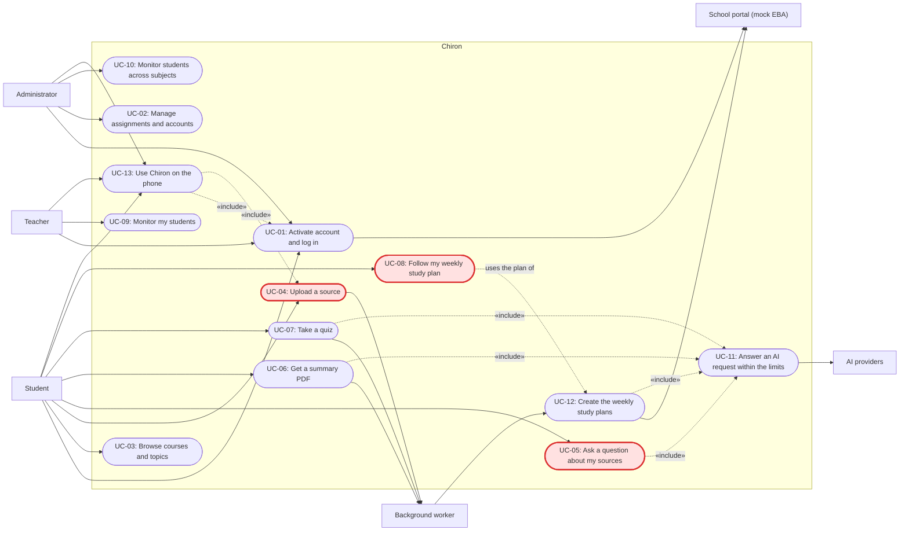
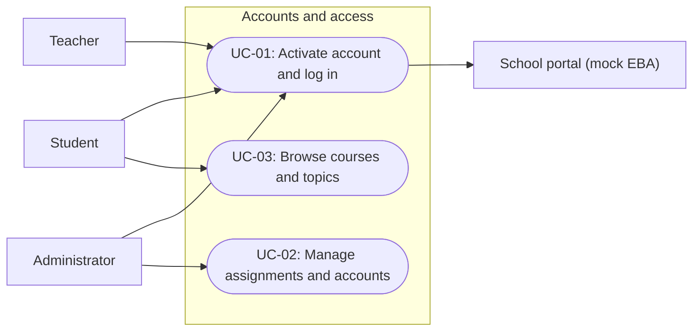
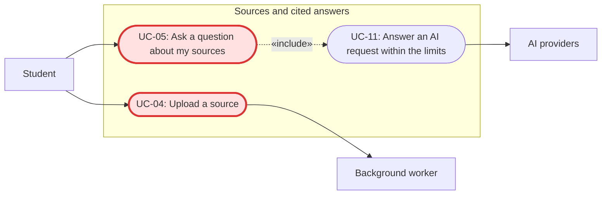
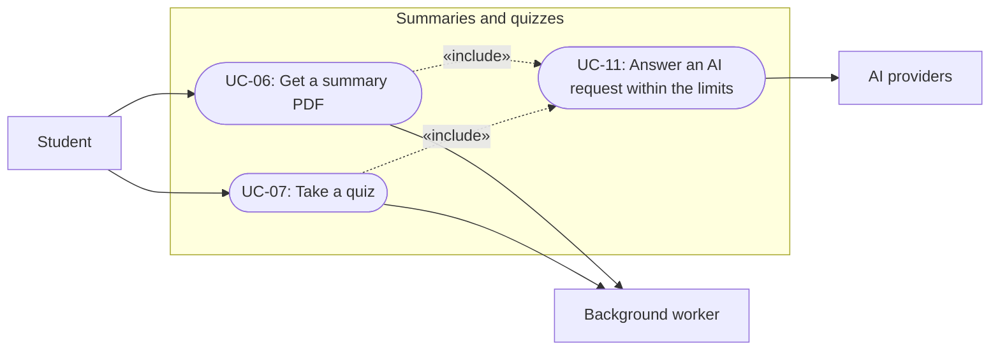
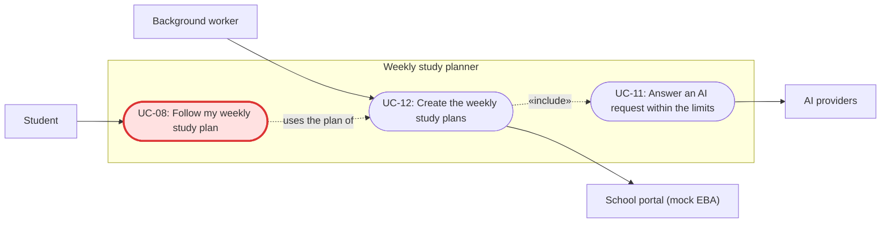
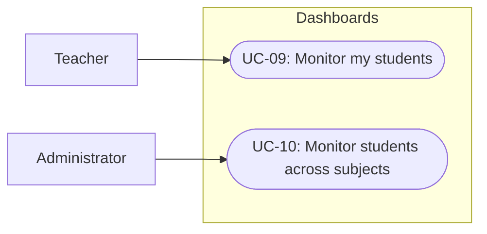
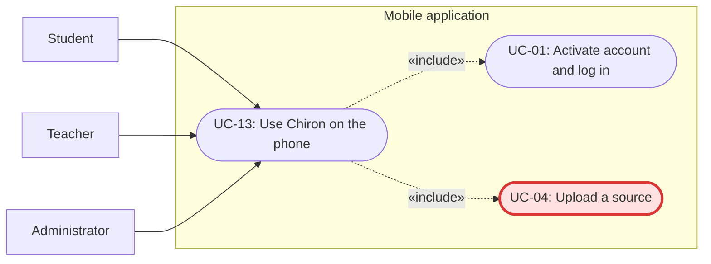

# Software Engineering — Requirements Specification

## Cover Page

| Field | Details |
|---|---|
| **Course** | BLG 411E Software Engineering |
| **Report name** | Requirements Specification |
| **Project title** | Chiron |
| **Group name / number** | Forge of Hephaistos |
| **Group members** | Burak Emre Polat — 150230328, Metin Furkan Amarat — 150230301, Hasan Yalçın Arıkanoğlu — 150220341, Berkay Türk — 150220320, Abdullah Faruk Özbek — 150220327 |
| **Instructor** | Prof. Dr. Tolga Ovatman, Assoc. Prof. Dr. Ayşe Tosun |
| **Submission date** | 2026-11-08 |
| **Document version** | 1.0 |

---

## 1. Introduction

Chiron is an AI-powered study assistant for EBA-like Turkish online education portals. Students upload their course sources, ask questions that are answered with citations to those sources, generate summaries (as PDF) and quizzes, and get a weekly study plan with study hours and steps for their weakest topics. Teachers and administrators follow the results and AI usage of the students assigned to them. Chiron is used through a web application and Android and iOS applications built from the same frontend; the school portal is simulated with a mock EBA adapter.

This document describes what Chiron must do, so that the customer can check that we understood the needs and so that every requirement can be tested later. It builds on the Project Charter and Project Plan v1.1 and keeps their task (T-##), deliverable (D-##) and work-breakdown (WBS-#.#) IDs. The requirements come from the charter, Customer Meeting 1 (14.10.2026, issues #1 to #3), the TA review of Project Plan v1.0 (31.10.2026) and the follow-up customer meeting (issue #4, mobile application), and team decisions where the details were still open. Following the course guidelines, every requirement has a unique ID and a source; mandatory requirements use "shall", desirable ones "should", and optional scope "could".

Section 2 lists the functional and non-functional requirements. Section 3 describes the user types, personas and scenarios, the user stories for the WBS activities of the Project Plan, the use case diagrams, a coverage matrix that links every task to its requirements and use cases, and the detailed use cases with their alternative and error flows.

---

## 2. System Requirements

### 2.1 Functional Requirements

| Requirement ID | Related task ID(s) | Related deliverable ID(s) | Functional requirement (natural language) | Priority | Verification / acceptance condition |
|---|---|---|---|---|---|
| FR-01 | T-01 | D-01 | The system shall run long tasks (processing an upload, generating a summary or a quiz) in the background and show the user their status (waiting, running, done or failed). | Must | Start a job and see its status change; a job that fails or runs longer than 2 minutes is shown as failed |
| FR-02 | T-02 | D-01, D-03 | The system shall let a user whose account exists in the portal data activate it with their portal ID by setting a password the first time they log in. | Must | A user from the mock portal activates the account and can then log in; a portal ID that does not exist is rejected |
| FR-03 | T-02 | D-01, D-03 | The system shall let users log in with their portal ID and password. | Must | Log in with a valid account and reach the start page of the role |
| FR-04 | T-02 | D-01, D-03 | The system shall let users log out, after which their session can no longer be used. | Must | Log out and try to open a page with the old session; the login page is shown |
| FR-05 | T-02 | D-01, D-03 | The system shall answer a wrong portal ID or a wrong password with the same error message, without telling which of the two was wrong. | Must | A wrong ID and a wrong password give exactly the same message |
| FR-06 | T-02 | D-01, D-03 | The system shall show each user only the pages and functions of their role (student, teacher or administrator). | Must | Authorization tests for each role (WBS-2.2); a student cannot open teacher or administrator pages |
| FR-07 | T-02 | D-01 | The system shall let a teacher see the data of only the students assigned to them in the subject they teach, and an administrator the data of only the students assigned to them. | Must | Tests try to open data of students who are not assigned and get an access error (WBS-2.2, WBS-7.1) |
| FR-08 | T-02 | D-01, D-03 | The system shall let an administrator change which students are assigned to which teacher and which teachers are assigned to which administrator. | Must | An administrator moves a student to another teacher and the dashboards change accordingly |
| FR-09 | T-02 | D-01, D-03 | The system shall let an administrator delete a user account together with its uploaded sources and generated material. | Must | After deletion the account cannot log in and its files and results are gone |
| FR-10 | T-03 | D-01 | The system shall show a student the courses, units and topics of their classes as given in the school portal data. | Must | The student sees exactly the courses and topics of the mock portal data |
| FR-11 | T-03 | D-01 | The system shall read each student's per-topic grades from the portal when the student logs in and before every weekly planning run. | Must | Change a grade in the mock portal data; it shows after the next login and is used in the next weekly plan |
| FR-12 | T-03 | D-01 | The system shall import the user accounts and the student, teacher and administrator assignments from the portal when Chiron is set up for a school, and shall add new accounts with their assignments on later imports started by an administrator, without changing existing assignments. | Must | After the first import, accounts and assignments match the mock portal data; a student added to the mock portal after setup can activate an account after the next import, and earlier assignment changes stay |
| FR-13 | T-04 | D-01, D-03 | The system shall let a student upload PDF files of up to 20 MB as sources for one of their courses, up to 20 sources per course. | Must | Upload a 19 MB PDF successfully; the 21st source of a course is refused |
| FR-14 | T-04 | D-01, D-03 | The system should also accept Word (DOCX) and PowerPoint (PPTX) files as sources, with the same limits. | Should | Upload a DOCX and a PPTX file and use them in a question; citations point to the heading or the slide |
| FR-15 | T-04 | D-01, D-03 | The system shall reject a file that is not in an accepted format (FR-13, FR-14), is larger than 20 MB, has no readable text (for example a scanned image) or goes over the course's source limit, and shall tell the student the reason and the accepted formats. | Must | Upload an old .doc file, a 25 MB PDF and a scanned PDF without text and get a different, clear message for each (WBS-4.2) |
| FR-16 | T-04 | D-01, D-02 | The system shall process an uploaded source in the background and show the student when it is ready to be used in questions, summaries and quizzes. | Must | The source shows "processing" and then "ready"; it can only be selected when it is ready |
| FR-17 | T-04 | D-01, D-03 | The system shall let a student see and delete their own sources; a deleted source is no longer used in answers, summaries or quizzes. | Must | Delete a source and ask a question whose answer was only in it; the system says it has no answer |
| FR-18 | T-04 | D-02, D-03 | The system shall answer a student's question in Turkish using only the selected sources, and shall show citations that link each part of the answer to the source passages it is based on (the page of a PDF, the slide of a PPTX or the heading of a DOCX file). | Must | On the evaluation set at least 80% of the answers cite a correct source passage (WBS-10.2); clicking a citation opens the passage |
| FR-19 | T-04 | D-02, D-03 | The system shall tell the student when the selected sources do not contain an answer, instead of answering from outside the sources. | Must | Questions about content that is not in the sources get the "no answer in your sources" message |
| FR-20 | T-04 | D-01, D-03 | The system should keep the student's previous questions and answers for each course so that they can read them again. | Should | Log out and in again and see the earlier questions of the course |
| FR-21 | T-05 | D-02, D-03 | The system shall generate a summary of the selected sources in Turkish and give it to the student as a PDF to download. | Must | At least 95% of generated summaries compile to PDF on the evaluation set (WBS-10.2); the PDF opens on the computer and the phone |
| FR-22 | T-05 | D-02, D-03 | The system shall generate a multiple-choice quiz of 5 to 10 questions from the selected sources, with each question tagged with its topic. | Must | Generated quizzes have 5 to 10 questions, each with one correct option, a topic and a source passage (WBS-5.2) |
| FR-23 | T-05 | D-03 | The system shall let the student answer the quiz and, after submitting, show the score, the correct answers and a citation to the source passage of each question. | Must | Submit a quiz and see the score, the correct options and a working citation for every question |
| FR-24 | T-05 | D-02 | The system shall save the student's quiz answers and score per topic. | Must | After a quiz the results are stored and shown again when the student reopens it |
| FR-25 | T-05 | D-02, D-03 | The system shall show an error message and let the student try again when a summary or a quiz cannot be generated. | Must | Simulate a LaTeX compile error and an invalid AI answer; the job ends as failed with a message and a retry button (WBS-5.2) |
| FR-26 | T-05 | D-02, D-03 | The system could generate flashcards from the selected sources. | Could | Only if built: flashcards are generated from the sources and each one shows its source passage |
| FR-27 | T-06 | D-01 | The system shall compute each student's success rate per topic and the class average per topic from the grades in the portal. | Must | For sample students and classes with known grades the computed rates and averages match the hand-calculated ones (WBS-6.2) |
| FR-28 | T-06 | D-01 | The system shall mark a topic as weak when the student's success rate in it is below 60%, or when it is at least 15 points below the class average for that topic; the class average is only used when at least 5 students of the class have grades in the topic. | Must | A topic at 59% is weak; a topic at 70% is weak when the class average is 90% and not weak when it is 80%; with only 4 graded students the class average is not used |
| FR-29 | T-06 | D-02, D-03 | The system shall create a weekly study plan for the student's weak topics that gives, for each topic, the study hours for the week and the steps to take (reviewing the topic, solving practice questions). | Must | For sample students the plan lists every weak topic with the expected hours and steps (WBS-6.2) |
| FR-30 | T-06 | D-01 | The system shall create a new study plan for every student at the start of each week, using their latest grades. | Must | After the weekly run every student has a plan for the new week (UC-12) |
| FR-31 | T-06 | D-03 | The system should show, for each topic in the plan, the success rate that put it there and, when the class rule applies, the class average. | Should | Each plan entry shows the topic's success rate, and the class average for topics added by the class rule |
| FR-32 | T-07 | D-01, D-03 | The system shall show a teacher the per-topic success rates of their assigned students in the subject they teach. | Must | A teacher sees all and only their assigned students, with the correct rates (WBS-7.1) |
| FR-33 | T-07 | D-01, D-03 | The system shall show an administrator the per-topic success rates of their assigned students in all subjects. | Must | An administrator sees all and only their assigned students in every subject (WBS-7.1) |
| FR-34 | T-07 | D-01, D-03 | The system shall show teachers and administrators the AI token usage of each of their assigned students for a period they choose. | Must | The shown token totals match the recorded usage for the chosen dates |
| FR-35 | T-08 | D-02 | The system shall record the AI token usage of every request together with the student who made it. | Must | Every AI request in the tests creates a usage record with the right student and token count (WBS-8.2) |
| FR-36 | T-08 | D-02 | The system shall switch to another AI provider when the current one returns an error, rate-limits or does not answer in time, without the user having to do anything. | Must | With the first provider mocked as failing, the request is answered by the next one (WBS-8.2) |
| FR-37 | T-08 | D-02 | The system shall refuse new AI requests from a student who has reached their monthly token limit, and shall tell the student when the limit resets. | Must | A student over the limit gets the limit message and no AI request is sent (WBS-8.2) |
| FR-38 | T-12 | D-08 | The system shall provide Android and iOS applications that offer the same functions and roles as the web application and use the same accounts. | Must | All main flows pass the mobile smoke tests on the Android emulator and the iOS simulator (WBS-12.2) and on real phones before the demo (WBS-10.5) |
| FR-39 | T-12 | D-08 | The mobile applications shall let the user choose a source file on the phone to upload and open downloaded summary PDFs on the phone. | Must | Upload a PDF from the phone's files and open a downloaded summary on Android and iOS |
| FR-40 | T-12 | D-08 | The mobile applications shall keep the user logged in between uses by storing the login token in the phone's secure storage, until the user logs out. | Must | Close and reopen the application and stay logged in; after logging out the token is removed |
| FR-41 | T-12 | D-08 | The Android application should return to the previous screen when the phone's back button is pressed. | Should | Pressing back on any screen goes to the previous screen instead of closing the application |

**Functional requirement notes:**
- **Accounts:** in the Project Plan, "register" (T-02, WBS-2.3, WBS-2.4) means activating an account that already exists in the portal data; there is no public sign-up.
- **Portal data:** accounts and assignments are imported from the portal when Chiron is set up (FR-12); after that, administrators keep the assignments up to date (FR-08) and their changes take precedence over the portal data. Later imports, started by an administrator, only add new accounts (for example students who join during the term) and do not change existing assignments. Grades are read at every login and before every weekly planning run (FR-11), so the dashboards (FR-32, FR-33) show grades that are at most one week old even for students who do not log in.
- **Plan mapping:** FR-08 and FR-09 are built in WBS-2.3 (role checks and student assignments) and WBS-2.4 (account pages for all roles). FR-14 is a Should because the Project Plan's tests (WBS-4.2) assume PDF; if the team adds DOCX and PPTX to the plan, it becomes a Must.
- **Team decisions:** where the charter and the customer did not give details, we decided them as a team: PDF uploads (DOCX and PPTX as a Should) up to 20 MB and 20 sources per course, a topic is weak below a 60% success rate or 15 points under the class average, quizzes have 5 to 10 multiple-choice questions, students delete their own sources and administrators delete accounts, teachers only monitor and do not upload material. We will confirm these with the customer and change them through `customer-requests` issues if needed.
- **Formats (FR-13, FR-14, FR-15, FR-18):** old `.doc` and `.ppt` files and files without readable text (scanned images) are not supported. Citations point to the page of a PDF, the slide of a PPTX and the nearest heading of a DOCX, because Word files have no fixed pages.
- **Study hours (FR-29):** a weak topic gets 1 to 4 study hours for the week, more for a lower success rate: 50-59% gives 1 hour, 40-49% 2 hours, 30-39% 3 hours and below 30% 4 hours. A topic that is weak only because it is far below the class average gets 1 hour.
- **Weekly run (FR-30):** "the start of each week" means Monday morning; the plan stays the same for the rest of the week.
- **Token limit (FR-37):** the monthly limit per student is set in the system configuration so that all students together stay under the team budget (NFR-19). The exact value is chosen in the Design Specification.
- **Dependencies:** FR-18, FR-21 and FR-22 only use sources that are ready (FR-16); every AI request goes through the gateway requirements (FR-35, FR-36, FR-37).

**Requirement sources and rationale:**

| Requirement ID | Source | Rationale |
|---|---|---|
| FR-01 | Charter (background job queue), Project Plan WBS-1.7 | Generation can take longer than a normal page load, and the user should not wait on a frozen screen. |
| FR-02 | Charter (authentication), team decision | Users come from the school portal, so there is no public sign-up. |
| FR-03 | Charter (authentication) | Only the owner of an account may see its study material and results. |
| FR-04 | Charter (authentication) | Shared computers are common at school and at home. |
| FR-05 | Team decision (security) | Telling which part was wrong would help someone guess valid portal IDs. |
| FR-06 | Charter (role-based access) | The three roles have different jobs and different rights. |
| FR-07 | Charter (dashboard), KVKK | Students' results are personal data and must only be visible to the staff responsible for them. |
| FR-08 | Team decision | The portal data gives the starting assignments, but schools change classes during the year. |
| FR-09 | KVKK, team decision | Personal data must be removable when a student leaves. |
| FR-10 | Charter (EBA mock adapter) | Students should not have to enter their courses by hand. |
| FR-11 | Charter (EBA mock adapter, study planner) | The study plan and the dashboards depend on up-to-date grades. |
| FR-12 | Charter (dashboard assignments), team decision | The portal already knows who teaches whom; later imports bring in students who join during the term without undoing the administrators' changes (FR-08). |
| FR-13 | Charter (source upload), team decision | The limits keep processing time and storage cost under control. |
| FR-14 | Team review | Teachers often share notes as Word files and lessons as slides. |
| FR-15 | Team decision | The student needs to know how to fix the problem. |
| FR-16 | Charter (RAG), Project Plan WBS-4.3 | Processing a PDF takes time, and an unfinished source would give wrong answers. |
| FR-17 | KVKK, team decision | Students control their own uploads. |
| FR-18 | Charter (cited RAG Q&A) | Citations let students check the answer instead of trusting the AI blindly. |
| FR-19 | Charter (answers grounded in sources) | An answer that is not based on the sources could be wrong and cannot be checked. |
| FR-20 | Team decision | Students often come back to the same questions while revising. |
| FR-21 | Charter (summary generation as PDF) | A summary is the fastest way to review before an exam. |
| FR-22 | Customer Meeting 1 (issue #3), team decision | The customer asked for quiz questions next to the summaries. |
| FR-23 | Customer Meeting 1 (issue #3), team decision | Students learn from their mistakes when they can see where the right answer comes from. |
| FR-24 | Project Plan WBS-5.4 | Students and teachers can look back at earlier quizzes. |
| FR-25 | Project Plan 1.4 (reliability) | A failed job must not leave the student waiting without knowing what happened. |
| FR-26 | Charter (stretch: additional study material formats) | Optional scope; it is built only if the must-have features are finished and tested. |
| FR-27 | Charter (weekly study planner) | The plan is based on how the student actually did in each topic. |
| FR-28 | Customer Meeting 1 (issue #2), team review | A fixed threshold alone misses topics where a student is far behind the class; the 5-student minimum keeps the average meaningful and does not reveal individual grades. |
| FR-29 | Customer Meeting 1 (issue #2) | The customer asked for hours and steps per weak topic instead of a general weekly evaluation. |
| FR-30 | Customer Meeting 1 (issue #2) | A weekly plan has to follow the student's newest results. |
| FR-31 | Project Plan WBS-6.1 (rules must be easy to explain) | Students trust a plan more when they see why a topic is in it. |
| FR-32 | Charter (teacher/admin dashboard) | Teachers can see who needs help in which topic. |
| FR-33 | Charter (teacher/admin dashboard) | Administrators follow results across subjects. |
| FR-34 | Charter (token usage on the dashboard) | Schools need to see how much AI each student uses. |
| FR-35 | Charter (per-student token tracking) | The dashboards and the cost limits need this data. |
| FR-36 | Charter (multi-model gateway with fallback) | One provider being down must not stop students from studying. |
| FR-37 | Charter (cost control), Project Plan 1.1 (budget) | The team has a fixed monthly budget for AI usage. |
| FR-38 | TA review of Project Plan v1.0 and the follow-up customer meeting (issue #4) | The customer made the mobile application mandatory. |
| FR-39 | TA review of Project Plan v1.0 and the follow-up customer meeting (issue #4) | Upload and PDF download are the parts most likely to behave differently inside a phone application. |
| FR-40 | Project Plan 1.4 (portability) | Logging in every time on a phone is annoying, and the token must not be stored in plain text. |
| FR-41 | Project Plan WBS-12.1 | Android users expect the back button to work like this. |

### 2.2 Non-functional Requirements

| Requirement ID | Quality attribute | Non-functional requirement (natural language) | Applies to | Verification / measurement |
|---|---|---|---|---|
| NFR-01 | Security | The system shall store passwords only as salted hashes. | FR-02, FR-03 | Code review and a database check that no plain passwords are stored (WBS-10.1, WBS-10.3) |
| NFR-02 | Security | The system shall keep API keys and other secrets outside the source code. | Whole system | Code review and a secret scan in CI (WBS-10.1) |
| NFR-03 | Security | The system shall check the user's role and assignments on every API call. | FR-06, FR-07 | Authorization tests for every role, including access to other users' data (WBS-2.2, WBS-7.1) |
| NFR-04 | Privacy (KVKK) | The system shall store only the personal data its functions need. | Whole system | Review of the stored data against the access and privacy design (WBS-2.1, WBS-10.3) |
| NFR-05 | Privacy (KVKK) | No real student data shall be used during development and testing. | Whole system | Check of the development and test data sets (WBS-10.3) |
| NFR-06 | Privacy (KVKK) | The system shall remove all of a user's personal data when the account is deleted. | FR-09, FR-17 | Deletion test that checks the database and the file storage (WBS-10.3) |
| NFR-07 | Security | The system shall treat the text of uploaded files only as content, so that instructions written inside a file cannot change how the AI behaves or what data it shows. | FR-18, FR-21, FR-22 | Prompt-injection tests with prepared PDFs (WBS-10.3) |
| NFR-08 | Performance | Normal API calls shall answer within 1 second on average in the load test with 20 users at the same time. | Whole system | Simple load test on the deployed system (WBS-10.3) |
| NFR-09 | Performance | A cited answer shall start to appear within 10 seconds after the question is sent. | FR-18 | Timed questions in the load test (WBS-10.3) |
| NFR-10 | Performance | Summary and quiz jobs shall show their status and finish within 2 minutes. | FR-01, FR-21, FR-22 | Timed jobs in the load test (WBS-10.3) |
| NFR-11 | Usability | The interface shall be in Turkish, and generated answers and study material shall be in Turkish, also when the question or the source is in English; quoted passages keep their original language. | UT-01, UT-02, UT-03; FR-18, FR-21, FR-22 | Review of all pages and of the evaluation answers to English questions (WBS-10.2, WBS-10.4) |
| NFR-12 | Usability | Every role shall have clear navigation to its main functions. | UT-01, UT-02, UT-03 | Usability sessions (WBS-10.4) |
| NFR-13 | Usability | All pages shall be usable on phone screens from 360 px wide. | All pages; FR-38 | Phone viewport tests (WBS-12.2) |
| NFR-14 | Usability | The System Usability Scale (SUS) score shall be at least 70. | UT-01 | Usability sessions with at least 5 students and the SUS questionnaire (WBS-10.4) |
| NFR-15 | Accessibility | Every page shall support keyboard navigation and have enough contrast, labels and alternative texts (WCAG 2.1 AA basics). | All pages | Lighthouse accessibility score of at least 90 on every page and a keyboard-only walkthrough of the main flows (WBS-10.4) |
| NFR-16 | Portability | The mobile applications shall run on Android 10 or later and iOS 15 or later and offer the same functions as the web application with the same backend API and accounts. | FR-38, FR-39, FR-40, FR-41 | Smoke tests on an Android emulator in CI and on the iOS simulator (WBS-12.2); check on a real Android phone and iPhone (WBS-10.5) |
| NFR-17 | Reliability | If an AI provider fails, the system shall retry and fall back to another provider. | FR-36 | Provider-failure tests (WBS-8.2) |
| NFR-18 | Reliability | A generation job that fails or runs longer than 2 minutes shall be marked as failed, and the user shall see an error message. | FR-01, FR-25 | Job-failure tests (WBS-5.2) |
| NFR-19 | Cost | Paid AI usage shall stay under $20 per month for the whole team, with token usage recorded per student and a monthly limit per student enforced. | FR-35, FR-37 | Budget limit tests (WBS-8.2); monthly usage on the dashboard |
| NFR-20 | AI output quality | On the evaluation set, at least 80% of the answers shall cite a correct source passage. | FR-18 | Evaluation runs on about 50 Turkish and English questions (WBS-10.2) |
| NFR-21 | AI output quality | On the evaluation set, at least 95% of the generated summaries shall compile to PDF. | FR-21 | Evaluation runs on the summaries of the evaluation sources (WBS-10.2) |
| NFR-22 | Maintainability | The backend shall have at least 80% test coverage (course standard). | Whole system | Coverage report in CI (WBS-1.5) |
| NFR-23 | Maintainability | The code shall pass the linters before it is merged. | Whole system | Lint checks in CI (WBS-1.4) |
| NFR-24 | Maintainability | Every change shall be reviewed in a pull request before it is merged. | Whole system | Branch protection on main and PR review (WBS-1.4, WBS-10.1) |
| NFR-25 | Deployability | The system shall be available online on the cloud service, and every change merged into the main branch shall be deployed automatically after all tests pass. | Whole system | A merged change appears on the deployed system without manual steps; a change with a failing test is not deployed (WBS-9.2) |
| NFR-26 | Architecture constraint | The web and the mobile applications shall use the same documented REST API for all functions. | Whole system; FR-38 | The API matches the OpenAPI contracts; contract tests pass in CI (WBS-1.1, WBS-1.5) |

**Non-functional requirement notes / assumptions:**
- All thresholds are the ones agreed in Project Plan v1.1 (Section 1.4 and deliverable D-02); none were added in this document. "Within 1 second on average" makes the plan's "about 1 second" measurable without changing it.
- NFR-25 (deployability) and NFR-26 (one REST API) are constraints on how the system is built and delivered, so they are listed here instead of as functional requirements.
- "20 users at the same time" is the expected load of a class trying Chiron during a lesson or the demo, not of a whole school.
- "Normal API calls" are all calls that do not wait for an AI answer or a background job, such as logging in, listing sources or opening the dashboard.
- Supported environments: the current versions of common desktop and mobile browsers, Android 10 or later and iOS 15 or later.
- The requirements must hold on the deployed GCP system with the mock portal data; a real EBA connection is out of scope.

---

## 3. Use Cases

### 3.1 User Types

| User type ID | User type / actor | Description and responsibilities | Goals / typical actions | Related requirement ID(s) |
|---|---|---|---|---|
| UT-01 | Student | Primary human actor. A K-12 student whose account comes from the school portal. | Uploads sources, asks questions, makes summaries and quizzes, follows the weekly study plan, on the web or the phone | FR-02, FR-03, FR-10, FR-13, FR-18, FR-21, FR-22, FR-23, FR-29, FR-38 |
| UT-02 | Teacher | Primary human actor. Teaches one subject to the students assigned to them. | Follows the per-topic results and the AI usage of their students in their subject | FR-03, FR-07, FR-32, FR-34 |
| UT-03 | Administrator | Primary human actor. School staff member responsible for Chiron and for a group of teachers and students. | Follows results in all subjects, manages assignments and deletes accounts | FR-03, FR-07, FR-08, FR-09, FR-33, FR-34 |
| UT-04 | School portal (mock EBA) | Secondary actor, external system. Provides accounts, assignments, courses, topics and grades through the adapter. | Gives Chiron the school data it needs | FR-10, FR-11, FR-12 |
| UT-05 | AI providers | Secondary actors, external systems. Language model services called through the gateway. | Generate answers, summaries, quiz questions and study steps | FR-18, FR-21, FR-22, FR-29, FR-36 |
| UT-06 | Background worker | Secondary actor, automated. Runs long tasks and the weekly planning run. | Processes uploads, generates summaries and quizzes, creates the weekly plans | FR-01, FR-16, FR-30 |

**Access or role distinctions:**
Students only see and change their own sources, answers, quizzes and plans. Teachers see the results and AI usage of their assigned students, and only in the subject they teach. Administrators see their assigned students in every subject and are the only role that can change assignments and delete accounts. None of the roles can see another user's uploaded files. The secondary actors have no user interface: the school portal only provides data, the AI providers only receive requests through the gateway, and the background worker runs inside the system.

### 3.2 User Scenarios

The scenarios use the following personas (made up for this document):

- **P-01 — Elif:** A 10th-grade student in Istanbul. She studies at home on a laptop and on the bus with her phone, and she is weak in a few chemistry topics.
- **P-02 — Murat Bey:** A chemistry teacher with three 10th-grade classes who wants to see which topics his students struggle with.
- **P-03 — Ayşe Hanım:** The school's administrator for Chiron. She keeps the class assignments right and watches the AI usage.

**SC-01 — Getting started**  
**Persona:** P-01 — Elif  
**Related requirements:** FR-02, FR-03, FR-10, FR-11

At the start of the term Elif hears from her teacher that the school now uses Chiron. She opens the website, enters her portal ID and is asked to set a password because it is her first login. After that she sees her courses and their topics, already filled in from the school portal, so she does not have to set anything up.

**SC-02 — Asking about the course notes**  
**Persona:** P-01 — Elif  
**Related requirements:** FR-13, FR-15, FR-16, FR-18, FR-19

Elif has a chemistry test on Friday and three PDFs from her teacher. She uploads them to her chemistry course; one of them is a scanned page without any text, and Chiron tells her it cannot find readable text in that file. A few minutes later the other two are marked as ready. She asks how ionic and covalent bonds differ. The answer comes in Turkish, and each part has a citation; when she clicks one, the page it comes from opens. When she asks about a topic that is not in the notes, Chiron tells her the answer is not in her sources.

**SC-03 — Revising before the test**  
**Persona:** P-01 — Elif  
**Related requirements:** FR-01, FR-21, FR-22, FR-23, FR-24, FR-25

The night before the test Elif asks for a summary of the two PDFs and a quiz. Chiron shows that both are being prepared. The summary arrives as a PDF she can download, and the quiz has eight multiple-choice questions. After she submits her answers, she sees her score, the right answers and, for each question, the passage it came from. She got the questions on chemical bonds wrong, so she rereads those passages.

**SC-04 — Following the weekly plan**  
**Persona:** P-01 — Elif  
**Related requirements:** FR-27, FR-28, FR-29, FR-30, FR-31

On Monday Elif opens her study plan. Chiron has used her latest grades from the portal and lists three weak topics: two where she is below 60%, and one where she has 70% while her class average is 88%. For each one it shows her success rate (and the class average where it applies), how many hours to spend this week and what to do: review the topic, then solve practice questions. The topic where she is weakest gets the most hours. She plans her week around it.

**SC-05 — A teacher checks his classes**  
**Persona:** P-02 — Murat Bey  
**Related requirements:** FR-07, FR-32, FR-34

Before the next unit Murat Bey opens his dashboard. He sees only the students assigned to him and only in chemistry. The per-topic success rates show that many students are weak in chemical bonds, so he plans a revision lesson. He also checks the AI usage of his students for the last month.

**SC-06 — The administrator fixes an assignment**  
**Persona:** P-03 — Ayşe Hanım  
**Related requirements:** FR-08, FR-09, FR-33, FR-34

A student changed class, but the assignments imported from the portal at the start of the term still put her with her old teacher. Ayşe Hanım moves her to the new teacher, and the new teacher's dashboard shows her from then on. She then looks at the results of all her students across subjects and their AI usage. When a student leaves the school, she deletes the account, and the student's files and results are removed.

**SC-07 — Studying on the phone**  
**Persona:** P-01 — Elif  
**Related requirements:** FR-38, FR-39, FR-40, FR-41

On the bus Elif opens the Chiron app on her phone. She is still logged in from yesterday. She picks a new PDF from her phone's files and uploads it, then opens yesterday's summary PDF and reads it on the screen. When she presses the back button, the app goes back to the previous screen.

**SC-08 — An AI provider goes down**  
**Persona:** P-01 — Elif  
**Related requirements:** FR-35, FR-36, FR-37

While Elif is asking a question, the first AI provider stops answering. Chiron switches to another provider and she gets her answer as usual, without noticing anything. Every request is counted against her monthly token limit; near the end of a busy month she reaches it, and Chiron tells her when she can use the AI features again.

#### User Stories Linked to the Project Plan

| User story ID | Scenario ID | Project Plan WBS activity ID | User story | Related requirement ID(s) |
|---|---|---|---|---|
| None | None | WBS-1.1 | Internal activity, no user story (architecture and API contracts); its result is required by NFR-26. | None |
| None | None | WBS-1.2 | Internal activity, no user story (database design). | None |
| None | None | WBS-1.3 | Internal activity, no user story (repository setup). | None |
| None | None | WBS-1.4 | Internal activity, no user story (CI pipeline); supports NFR-23 and NFR-24. | None |
| None | None | WBS-1.5 | Internal activity, no user story (test infrastructure); supports NFR-22. | None |
| US-01 | SC-07 | WBS-1.6 | As a student, I want the pages to work on both my laptop and my phone so that I can study anywhere. | FR-38 |
| US-02 | SC-03 | WBS-1.7 | As a student, I want to see whether my summary or quiz is still being prepared so that I know when to come back. | FR-01 |
| None | None | WBS-2.1 | Internal activity, no user story (access and privacy design); its result is in FR-07, FR-09 and NFR-04. | FR-07, FR-09 |
| None | None | WBS-2.2 | Internal activity, no user story (authorization tests). | None |
| US-03 | SC-01 | WBS-2.3 | As a user, I want to log in with my portal ID, log out and see only what my role allows so that my data stays private. | FR-03, FR-04, FR-05, FR-06, FR-07 |
| US-04 | SC-06 | WBS-2.3 | As an administrator, I want to change student and teacher assignments and delete accounts so that the data stays correct when classes change. | FR-08, FR-09 |
| US-05 | SC-01 | WBS-2.4 | As a new user, I want to activate my account by setting a password on my first login so that I can start using Chiron. | FR-02 |
| None | None | WBS-3.1 | Internal activity, no user story (portal data design and mock data). | None |
| None | None | WBS-3.2 | Internal activity, no user story (adapter tests). | None |
| US-06 | SC-01 | WBS-3.3 | As a student, I want my courses, topics and grades to come from the school portal so that I do not have to enter them myself. | FR-10, FR-11, FR-12 |
| None | None | WBS-4.1 | Internal activity, no user story (processing and retrieval design). | None |
| None | None | WBS-4.2 | Internal activity, no user story (processing and question answering tests). | None |
| US-07 | SC-02 | WBS-4.3 | As a student, I want to upload my course notes and slides (PDF, and Word or PowerPoint if supported) so that I can ask questions about them. | FR-13, FR-14, FR-15, FR-16, FR-17 |
| US-08 | SC-02 | WBS-4.4 | As a student, I want answers that show which part of my sources they come from so that I can check them. | FR-18, FR-19 |
| US-09 | SC-02 | WBS-4.5 | As a student, I want to click a citation and read the passage and my earlier questions so that I can study around the answer. | FR-18, FR-20 |
| None | None | WBS-5.1 | Internal activity, no user story (summary and quiz design). | None |
| None | None | WBS-5.2 | Internal activity, no user story (summary and quiz tests). | None |
| US-10 | SC-03 | WBS-5.3 | As a student, I want a PDF summary of my sources so that I can review them quickly before a test. | FR-21, FR-25 |
| US-11 | SC-03 | WBS-5.4 | As a student, I want a quiz made from my sources so that I can test myself. | FR-22, FR-24 |
| US-12 | SC-03 | WBS-5.5 | As a student, I want to solve the quiz and see the right answers with their sources so that I learn from my mistakes. | FR-23 |
| None | None | WBS-6.1 | Internal activity, no user story (study plan design). | None |
| None | None | WBS-6.2 | Internal activity, no user story (study planner tests). | None |
| US-13 | SC-04 | WBS-6.3 | As a student, I want Chiron to find my weak topics every week, also compared with my class, so that I know where to focus. | FR-27, FR-28, FR-30 |
| US-14 | SC-04 | WBS-6.4 | As a student, I want to see how many hours to spend on each weak topic and what to do so that I can plan my week. | FR-29, FR-31 |
| None | None | WBS-7.1 | Internal activity, no user story (dashboard tests). | None |
| US-15 | SC-05 | WBS-7.2 | As a teacher, I want the per-topic success rates of my students so that I can see who needs help. | FR-32 |
| US-16 | SC-06 | WBS-7.3 | As an administrator, I want to see my students' results in all subjects and their AI usage so that I can follow how the school uses Chiron. | FR-33, FR-34 |
| None | None | WBS-8.1 | Internal activity, no user story (gateway design). | None |
| None | None | WBS-8.2 | Internal activity, no user story (gateway tests). | None |
| US-17 | SC-08 | WBS-8.3 | As a student, I want to get answers even when one AI provider is down so that I am not stuck before a test. | FR-35, FR-36, FR-37 |
| None | None | WBS-9.1 | Internal activity, no user story (deployment design). | None |
| None | None | WBS-9.2 | Internal activity, no user story (Docker, GCP and deployment pipeline); its result is required by NFR-25. | None |
| None | None | WBS-10.1 | Internal activity, no user story (PR review); supports NFR-24. | None |
| None | None | WBS-10.2 | Internal activity, no user story (AI evaluation); verifies NFR-20 and NFR-21. | None |
| None | None | WBS-10.3 | Internal activity, no user story (security, privacy and performance tests); verifies NFR-04, NFR-05, NFR-06, NFR-07, NFR-08, NFR-09 and NFR-10. | None |
| None | None | WBS-10.4 | Internal activity, no user story (usability and accessibility check); verifies NFR-12, NFR-14 and NFR-15. | None |
| None | None | WBS-10.5 | Internal activity, no user story (end-to-end tests and stabilization). | None |
| None | None | WBS-10.6 | Internal activity, no user story (integration of AI-drafted code). | None |
| None | None | WBS-11.1 | Internal activity, no user story (Project Plan). | None |
| None | None | WBS-11.2 | Internal activity, no user story (this document). | None |
| None | None | WBS-11.3 | Internal activity, no user story (wireframes and UI design). | None |
| None | None | WBS-11.4 | Internal activity, no user story (Requirements Analysis). | None |
| None | None | WBS-11.5 | Internal activity, no user story (Design Specification). | None |
| None | None | WBS-11.6 | Internal activity, no user story (Test Specification). | None |
| None | None | WBS-11.7 | Internal activity, no user story (demo and final presentation). | None |
| None | None | WBS-11.8 | Internal activity, no user story (project management). | None |
| None | None | WBS-12.1 | Internal activity, no user story (mobile application design). | None |
| None | None | WBS-12.2 | Internal activity, no user story (mobile tests); verifies NFR-13 and NFR-16. | None |
| US-18 | SC-07 | WBS-12.3 | As a student, I want a Chiron app on my phone that keeps me logged in so that I can study without a laptop. | FR-38, FR-40 |
| US-19 | SC-07 | WBS-12.4 | As a student, I want to upload files from my phone, open my summaries there and use the back button so that the app works like the website. | FR-39, FR-41 |

We added a user story ID column so that the `US-##` IDs exist. Internal activities have no user story, scenario or requirement of their own, so those cells say "None". WBS-2.3 has two user stories because it covers both logging in and the administrator's assignments.

### 3.3 Use Case Diagrams

The diagrams are drawn in Mermaid, which GitHub shows directly: actors are boxes, use cases are rounded shapes inside the system boundary, dashed arrows are «include» relationships, and critical use cases are red.

#### 3.3.1 Whole-System Use Case Diagram

**Whole-system diagram notes:**  
The three human actors are on the left and the three secondary actors on the right. UC-05, UC-06, UC-07 and UC-12 include UC-11, because every AI request goes through the gateway with its limits and fallback. UC-04, UC-06 and UC-07 hand their work to the background worker, which also starts UC-12 every week; UC-08 uses the plan that UC-12 creates. UC-13 gives the human actors the same use cases on the phone and includes UC-01 and UC-04, which behave differently there. The critical use cases (red) are UC-04, UC-05 and UC-08: without sources there is nothing to study with, cited answers are the core of the product, and the weekly study plan was the main customer request. Every task of the Project Plan with user-facing behavior is represented (see 3.4.1).

#### 3.3.2 Functionality-Specific Use Case Diagram — Accounts and access

**Functionality covered:** T-02, T-03 / FR-02 to FR-12 / UC-01, UC-02, UC-03  
**Diagram notes:** Accounts and assignments are imported from the school portal once; grades are read at login. Only the administrator can change assignments and delete accounts, and these changes are kept.

#### 3.3.3 Functionality-Specific Use Case Diagram — Sources and cited answers

**Functionality covered:** T-04, T-08 / FR-13 to FR-20, FR-35 to FR-37 / UC-04, UC-05, UC-11  
**Diagram notes:** Uploaded sources are processed by the background worker. Every question goes through UC-11, which applies the token limit and the provider fallback.

#### 3.3.4 Functionality-Specific Use Case Diagram — Summaries and quizzes

**Functionality covered:** T-05 / FR-21 to FR-26 / UC-06, UC-07  
**Diagram notes:** Summaries and quizzes are generated as background jobs. Flashcards (FR-26, optional scope) are an alternative flow of UC-07 and are only built if the must-have features are finished.

#### 3.3.5 Functionality-Specific Use Case Diagram — Weekly study planner

**Functionality covered:** T-06, T-03, T-08 / FR-27 to FR-31 / UC-08, UC-12, UC-11  
**Diagram notes:** The background worker creates the plans every week from the latest grades (UC-12), and the study steps are written by the AI through UC-11; the student reads and follows the plan (UC-08). The dashed arrow only shows that UC-08 depends on the result of UC-12; it is not an include or extend relationship.

#### 3.3.6 Functionality-Specific Use Case Diagram — Dashboards

**Functionality covered:** T-07 / FR-32 to FR-34 / UC-09, UC-10  
**Diagram notes:** Teachers see their assigned students in their own subject; administrators see their assigned students in every subject. Both see token usage for a chosen period.

#### 3.3.7 Functionality-Specific Use Case Diagram — Mobile application

**Functionality covered:** T-12 / FR-38 to FR-41 / UC-13  
**Diagram notes:** The mobile application offers the same use cases as the web application. The diagram shows the two that behave differently on a phone: logging in with the stored token and uploading a file from the phone.

### 3.4 Use Cases

#### 3.4.1 Use Case Coverage Matrix

| Project Plan task ID | Functional requirement ID(s) | Use case ID(s) | Scenario ID(s) |
|---|---|---|---|
| T-01 | FR-01 | UC-04, UC-06, UC-07 | SC-02, SC-03 |
| T-02 | FR-02, FR-03, FR-04, FR-05, FR-06, FR-07, FR-08, FR-09 | UC-01, UC-02, UC-09, UC-10 | SC-01, SC-05, SC-06 |
| T-03 | FR-10, FR-11, FR-12 | UC-01, UC-02, UC-03, UC-12 | SC-01, SC-04 |
| T-04 | FR-13, FR-14, FR-15, FR-16, FR-17, FR-18, FR-19, FR-20 | UC-04, UC-05 | SC-02 |
| T-05 | FR-21, FR-22, FR-23, FR-24, FR-25, FR-26 | UC-06, UC-07 | SC-03 |
| T-06 | FR-27, FR-28, FR-29, FR-30, FR-31 | UC-08, UC-12 | SC-04 |
| T-07 | FR-32, FR-33, FR-34 | UC-09, UC-10 | SC-05, SC-06 |
| T-08 | FR-35, FR-36, FR-37 | UC-11 | SC-08 |
| T-09 | None (deployment is NFR-25) | None (all use cases run on the deployed system) | None |
| T-10 | None (quality work, covered by the non-functional requirements) | None (internal) | None |
| T-11 | None (documents and project management) | None (internal) | None |
| T-12 | FR-38, FR-39, FR-40, FR-41 | UC-13 | SC-07 |

T-09, T-10 and T-11 have no functional requirement or use case of their own: deployment, testing and documentation do not have a user goal. Deployment is covered by NFR-25, and the single REST API built in T-01 (WBS-1.1) is an architecture constraint (NFR-26), so T-01 is linked to use cases only through the background jobs of FR-01. The optional flashcards (FR-26) are included as an alternative flow of UC-07 because they are part of the agreed optional scope.

#### 3.4.2 UC-01 — Activate account and log in

| Field | Description |
|---|---|
| **Use case ID** | UC-01 |
| **Use case name** | Activate account and log in |
| **Goal / Purpose** | Get access to Chiron with the portal account and see the functions of one's role. |
| **Actor(s)** | UT-01, UT-02, UT-03; UT-04 (secondary) |
| **Related Project Plan task(s)** | T-02, T-03 |
| **Related functional requirement(s)** | FR-02, FR-03, FR-04, FR-05, FR-06, FR-11 |

**Pre-condition(s):**  
The user's account and role were imported from the portal data (FR-12).

**Main success flow:**

1. **Actor:** Opens Chiron and enters their portal ID.
2. **System:** Finds the account among the imported accounts and, because it is the first login, asks for a new password.
3. **Actor:** Enters and confirms a password.
4. **System:** Activates the account, logs the user in and, for a student, reads the latest grades from the portal.
5. **System:** Shows the start page of the user's role (student, teacher or administrator).

**Alternative flows:**

- **A1 — Returning user (branches from step 2):**
  1. The account is already active.
  2. The system asks for the password instead of a new one.
  3. If the password is correct, the flow continues at step 4.
- **A2 — Log out (branches from step 5):**
  1. The user chooses to log out.
  2. The system ends the session.
  3. The flow ends on the login page.

**Exception / error flows (if applicable):**

- **E1 — Unknown portal ID (occurs at step 2):** The system shows the general login error message and the user stays on the login page.
- **E2 — Wrong password (occurs at step 2 of A1):** The system shows the same general login error message as in E1, so it does not tell which part was wrong.
- **E3 — Portal not reachable (occurs at step 4):** The user is logged in; a student sees the grades read last time and when they were updated.

**Post-condition(s):**  
The user is logged in and sees only the pages of their role.

**Acceptance scenario:**  
**Given** a student whose account exists in the portal data but is not activated  
**When** the student enters their portal ID and sets a password  
**Then** the system logs the student in and shows the student start page

#### 3.4.3 UC-02 — Manage assignments and accounts

| Field | Description |
|---|---|
| **Use case ID** | UC-02 |
| **Use case name** | Manage assignments and accounts |
| **Goal / Purpose** | Keep the student, teacher and administrator assignments correct, add users who join and remove the data of users who leave. |
| **Actor(s)** | UT-03 |
| **Related Project Plan task(s)** | T-02, T-03 |
| **Related functional requirement(s)** | FR-08, FR-09, FR-12 |

**Pre-condition(s):**  
The administrator is logged in; assignments have been read from the portal data.

**Main success flow:**

1. **Actor:** Opens the assignments page.
2. **System:** Shows the teachers and students assigned to the administrator.
3. **Actor:** Moves a student to another teacher.
4. **System:** Saves the change.
5. **System:** Shows the student in the new teacher's dashboard from now on.

**Alternative flows:**

- **A1 — Delete an account (branches from step 3):**
  1. The administrator chooses to delete a user and confirms.
  2. The system deletes the account with its sources and generated material.
  3. The flow ends; the user can no longer log in.
- **A2 — Import new accounts (branches from step 1):**
  1. The administrator starts a new import from the portal.
  2. The system adds the accounts that are new, with their assignments, and does not change existing assignments.
  3. The flow ends; the new users can activate their accounts (UC-01).
- **A3 — Move a teacher to another administrator (branches from step 3):**
  1. The administrator moves one of their teachers, with the teacher's students, to another administrator.
  2. The system saves the change.
  3. The flow continues at step 5 for the other administrator's dashboard.

**Exception / error flows (if applicable):**

- **E1 — Moving to a teacher outside the administrator's group (occurs at step 3):** The system refuses the change and explains that the teacher is not assigned to this administrator.

**Post-condition(s):**  
Assignments are updated and the dashboards follow them; a deleted user's data is gone.

**Acceptance scenario:**  
**Given** an administrator with student "S1" assigned to teacher "T1"  
**When** the administrator moves "S1" to teacher "T2"  
**Then** "S1" appears in the dashboard of "T2" and no longer in the dashboard of "T1"

#### 3.4.4 UC-03 — Browse courses and topics

| Field | Description |
|---|---|
| **Use case ID** | UC-03 |
| **Use case name** | Browse courses and topics |
| **Goal / Purpose** | See one's courses, units and topics without entering them by hand. |
| **Actor(s)** | UT-01 |
| **Related Project Plan task(s)** | T-03 |
| **Related functional requirement(s)** | FR-10 |

**Pre-condition(s):**  
The student is logged in; their grades were read from the portal at login (UC-01).

**Main success flow:**

1. **Actor:** Opens the courses page.
2. **System:** Shows the courses, units and topics of the student's classes.
3. **Actor:** Opens a course.
4. **System:** Shows the course's topics and the student's sources in it.

**Alternative flows:**

- **A1 — No courses yet (branches from step 2):**
  1. The portal data has no classes for the student.
  2. The system says that no courses are available yet and suggests contacting the administrator.
  3. The flow ends.

**Post-condition(s):**  
The student sees the courses and topics of the portal data.

**Acceptance scenario:**  
**Given** a student enrolled in "Kimya 10" in the portal data  
**When** the student opens the courses page  
**Then** the system shows "Kimya 10" with its units and topics

#### 3.4.5 UC-04 — Upload a source (critical)

| Field | Description |
|---|---|
| **Use case ID** | UC-04 |
| **Use case name** | Upload a source |
| **Goal / Purpose** | Add course material that Chiron can use for answers, summaries and quizzes. |
| **Actor(s)** | UT-01; UT-06 (secondary) |
| **Related Project Plan task(s)** | T-04, T-01 |
| **Related functional requirement(s)** | FR-01, FR-13, FR-14, FR-15, FR-16, FR-17 |

**Pre-condition(s):**  
The student is logged in and has opened one of their courses.

**Main success flow:**

1. **Actor:** Chooses "add source" and selects a file (PDF, or DOCX and PPTX if FR-14 is built).
2. **System:** Checks the file type, size and the course's source limit.
3. **System:** Stores the file and starts processing it in the background.
4. **System:** Shows the source as "processing".
5. **System:** Shows the source as "ready" when processing is done.

**Alternative flows:**

- **A1 — Delete a source (branches from step 1):**
  1. The student chooses to delete one of their sources and confirms.
  2. The system deletes it and stops using it in answers, summaries and quizzes.
  3. The flow ends.

**Exception / error flows (if applicable):**

- **E1 — Invalid file (occurs at step 2):** The file is not in an accepted format, is larger than 20 MB or goes over the limit of 20 sources; the system rejects it and shows the reason and the accepted formats.
- **E2 — No readable text (occurs at step 3):** The file has no text that can be read (for example a scanned image); the system marks the source as failed, shows a message and lets the student delete it or try another file.

**Post-condition(s):**  
The source is stored, processed and can be selected in the course.

**Acceptance scenario:**  
**Given** a student with 3 sources in a course  
**When** the student uploads a 5 MB PDF  
**Then** the source is shown as "processing" and later as "ready"

#### 3.4.6 UC-05 — Ask a question about my sources (critical)

| Field | Description |
|---|---|
| **Use case ID** | UC-05 |
| **Use case name** | Ask a question about my sources |
| **Goal / Purpose** | Get an answer that is based on one's own sources and can be checked. |
| **Actor(s)** | UT-01; UT-05 (secondary) |
| **Related Project Plan task(s)** | T-04, T-08 |
| **Related functional requirement(s)** | FR-18, FR-19, FR-20 |

**Pre-condition(s):**  
The student is logged in and has at least one ready source in the course.

**Main success flow:**

1. **Actor:** Selects one or more sources and writes a question.
2. **System:** Finds the passages of the selected sources that fit the question.
3. **System:** Asks an AI provider for an answer based only on those passages (includes UC-11).
4. **System:** Shows the answer in Turkish with citations to the passages.
5. **Actor:** Clicks a citation.
6. **System:** Opens the passage in the source and saves the question and answer in the course history.

**Alternative flows:**

- **A1 — No answer in the sources (branches from step 2):**
  1. No passage fits the question.
  2. The system tells the student that the selected sources do not contain an answer.
  3. The flow ends without an AI answer.

**Exception / error flows (if applicable):**

- **E1 — AI limit reached (occurs at step 3):** The student has reached their monthly token limit; the system shows the limit message and when it resets (UC-11).
- **E2 — No AI provider answers (occurs at step 3):** All providers fail; the system shows an error message and the student can ask again later.

**Post-condition(s):**  
The student has an answer with working citations, saved in the course history.

**Acceptance scenario:**  
**Given** a student with a ready source about chemical bonds  
**When** the student asks how ionic and covalent bonds differ  
**Then** the system answers in Turkish and every part of the answer has a citation to the source

#### 3.4.7 UC-06 — Get a summary PDF

| Field | Description |
|---|---|
| **Use case ID** | UC-06 |
| **Use case name** | Get a summary PDF |
| **Goal / Purpose** | Review the selected sources quickly with a summary to download. |
| **Actor(s)** | UT-01; UT-05, UT-06 (secondary) |
| **Related Project Plan task(s)** | T-05, T-01 |
| **Related functional requirement(s)** | FR-01, FR-21, FR-25 |

**Pre-condition(s):**  
The student is logged in and has at least one ready source in the course.

**Main success flow:**

1. **Actor:** Selects sources and asks for a summary.
2. **System:** Starts the summary job and shows it as "preparing".
3. **System:** Generates the summary in Turkish through the AI provider (includes UC-11) and turns it into a PDF.
4. **System:** Shows the summary as ready.
5. **Actor:** Downloads and opens the PDF.

**Alternative flows:**

- **A1 — Student leaves the page (branches from step 2):**
  1. The student closes the page while the job runs.
  2. The job continues; the summary is waiting in the course when the student comes back.
  3. The flow continues at step 4.

**Exception / error flows (if applicable):**

- **E1 — Generation fails (occurs at step 3):** The PDF cannot be created or the job runs longer than 2 minutes; the system marks the job as failed, shows a message and offers to try again.

**Post-condition(s):**  
A summary PDF of the selected sources is available in the course.

**Acceptance scenario:**  
**Given** a student with two ready sources  
**When** the student asks for a summary  
**Then** the system shows the job as "preparing" and then gives a PDF to download

#### 3.4.8 UC-07 — Take a quiz

| Field | Description |
|---|---|
| **Use case ID** | UC-07 |
| **Use case name** | Take a quiz |
| **Goal / Purpose** | Test oneself on the selected sources and learn from the mistakes. |
| **Actor(s)** | UT-01; UT-05, UT-06 (secondary) |
| **Related Project Plan task(s)** | T-05, T-01 |
| **Related functional requirement(s)** | FR-22, FR-23, FR-24, FR-25, FR-26 |

**Pre-condition(s):**  
The student is logged in and has at least one ready source in the course.

**Main success flow:**

1. **Actor:** Selects sources and asks for a quiz.
2. **System:** Generates 5 to 10 multiple-choice questions from the sources, each tagged with its topic (includes UC-11).
3. **Actor:** Answers the questions and submits.
4. **System:** Shows the score, the correct answers and a citation to the source passage of each question.
5. **System:** Saves the answers and the score per topic.

**Alternative flows:**

- **A1 — Flashcards instead of a quiz (optional scope) (branches from step 1):**
  1. If the optional flashcards are built, the student can ask for flashcards instead.
  2. The system generates flashcards with their source passages.
  3. The flow ends.

**Exception / error flows (if applicable):**

- **E1 — Generation fails (occurs at step 2):** The questions cannot be generated; the system shows a message and offers to try again.

**Post-condition(s):**  
The quiz result is saved and the student has seen the correct answers with their sources.

**Acceptance scenario:**  
**Given** a student with a ready source  
**When** the student asks for a quiz and submits the answers  
**Then** the system shows the score, the correct answers and a citation for each question

#### 3.4.9 UC-08 — Follow my weekly study plan (critical)

| Field | Description |
|---|---|
| **Use case ID** | UC-08 |
| **Use case name** | Follow my weekly study plan |
| **Goal / Purpose** | Know which topics to study this week, for how long and how. |
| **Actor(s)** | UT-01 |
| **Related Project Plan task(s)** | T-06 |
| **Related functional requirement(s)** | FR-27, FR-28, FR-29, FR-31 |

**Pre-condition(s):**  
The student is logged in; the weekly planning run (UC-12) has created the plan for this week.

**Main success flow:**

1. **Actor:** Opens the study plan.
2. **System:** Shows the weak topics of the week (success rate below 60%, or at least 15 points below the class average).
3. **System:** Shows for each topic the success rate (and the class average where it applies), the study hours for the week and the steps (review the topic, solve practice questions).
4. **Actor:** Opens a step.
5. **System:** Opens the topic's sources and suggests a quiz from them.

**Alternative flows:**

- **A1 — No weak topics (branches from step 2):**
  1. The student has no topic below 60% and none far below the class average.
  2. The system says there are no weak topics this week and suggests a quiz from the student's sources.
  3. The flow ends.

**Exception / error flows (if applicable):**

- **E1 — No grades in the portal yet (occurs at step 2):** The system says the plan will be created once grades are available.

**Post-condition(s):**  
The student sees this week's plan with hours and steps for each weak topic.

**Acceptance scenario:**  
**Given** a student with 45% in "chemical bonds", 70% in "atoms" where the class average is 90%, and 80% in "periodic table" where the class average is 82%  
**When** the student opens the study plan  
**Then** "chemical bonds" and "atoms" are listed with study hours and steps and "periodic table" is not listed

#### 3.4.10 UC-09 — Monitor my students

| Field | Description |
|---|---|
| **Use case ID** | UC-09 |
| **Use case name** | Monitor my students |
| **Goal / Purpose** | See which students need help in which topic of one's subject. |
| **Actor(s)** | UT-02 |
| **Related Project Plan task(s)** | T-07, T-02 |
| **Related functional requirement(s)** | FR-07, FR-32, FR-34 |

**Pre-condition(s):**  
The teacher is logged in and has assigned students.

**Main success flow:**

1. **Actor:** Opens the dashboard.
2. **System:** Shows the assigned students with their success rates per topic in the teacher's subject.
3. **Actor:** Chooses a period for the AI usage.
4. **System:** Shows the token usage of each student for that period.

**Alternative flows:**

- **A1 — No assigned students (branches from step 2):**
  1. The teacher has no assigned students.
  2. The system says so and suggests contacting the administrator.
  3. The flow ends.

**Exception / error flows (if applicable):**

- **E1 — Trying to open another student (occurs at step 2):** The teacher opens the link of a student who is not assigned; the system refuses access.

**Post-condition(s):**  
The teacher has seen the results and AI usage of only their own students.

**Acceptance scenario:**  
**Given** teacher "T1" with students "S1" and "S2" in chemistry  
**When** "T1" opens the dashboard  
**Then** the system shows "S1" and "S2" with their chemistry topics only

#### 3.4.11 UC-10 — Monitor students across subjects

| Field | Description |
|---|---|
| **Use case ID** | UC-10 |
| **Use case name** | Monitor students across subjects |
| **Goal / Purpose** | Follow the results and AI usage of one's students in every subject. |
| **Actor(s)** | UT-03 |
| **Related Project Plan task(s)** | T-07, T-02 |
| **Related functional requirement(s)** | FR-07, FR-33, FR-34 |

**Pre-condition(s):**  
The administrator is logged in and has assigned students.

**Main success flow:**

1. **Actor:** Opens the dashboard.
2. **System:** Shows the assigned students with their success rates per topic in all subjects.
3. **Actor:** Filters by subject or class and chooses a period.
4. **System:** Shows the filtered results and the token usage for that period.

**Alternative flows:**

- **A1 — No data for the period (branches from step 4):**
  1. No AI usage was recorded in the chosen period.
  2. The system shows zero usage for the period.
  3. The flow ends.

**Post-condition(s):**  
The administrator has seen the results and AI usage of their students.

**Acceptance scenario:**  
**Given** an administrator with 30 assigned students  
**When** the administrator filters by "10-A" for October  
**Then** the system shows only the students of "10-A" and their October token usage

#### 3.4.12 UC-11 — Answer an AI request within the limits

| Field | Description |
|---|---|
| **Use case ID** | UC-11 |
| **Use case name** | Answer an AI request within the limits |
| **Goal / Purpose** | Get an AI answer even if a provider fails, without going over the cost limits. |
| **Actor(s)** | UT-01 (through UC-05, UC-06, UC-07), UT-06 (through UC-12); UT-05 (secondary) |
| **Related Project Plan task(s)** | T-08 |
| **Related functional requirement(s)** | FR-35, FR-36, FR-37 |

**Pre-condition(s):**  
A use case has sent an AI request for a student (a logged-in student, or the weekly planning run for a student).

**Main success flow:**

1. **System:** Checks the student's monthly token limit.
2. **System:** Sends the request to the first AI provider.
3. **System:** Receives the answer and records the tokens used for the student.
4. **System:** Returns the answer to the use case that sent the request.

**Alternative flows:**

- **A1 — Provider fails (branches from step 2):**
  1. The provider returns an error, rate-limits or does not answer in time.
  2. The system retries and then sends the request to the next provider.
  3. The flow continues at step 3.

**Exception / error flows (if applicable):**

- **E1 — Limit reached (occurs at step 1):** The student has used their monthly limit; the system does not send the request and returns the limit message with the reset date.
- **E2 — All providers fail (occurs at step 2):** No provider answers; the system returns an error message to the use case.

**Post-condition(s):**  
The request is answered or refused with a clear reason, and its token usage is recorded.

**Acceptance scenario:**  
**Given** the first AI provider is not answering  
**When** a student asks a question  
**Then** the answer comes from the next provider and the tokens are recorded for the student

#### 3.4.13 UC-12 — Create the weekly study plans

| Field | Description |
|---|---|
| **Use case ID** | UC-12 |
| **Use case name** | Create the weekly study plans |
| **Goal / Purpose** | Give every student a new plan at the start of each week based on their latest grades. |
| **Actor(s)** | UT-06; UT-04, UT-05 (secondary) |
| **Related Project Plan task(s)** | T-06, T-03, T-08 |
| **Related functional requirement(s)** | FR-11, FR-27, FR-28, FR-29, FR-30 |

**Pre-condition(s):**  
It is the start of a new week.

**Main success flow:**

1. **System:** The background worker starts the weekly planning run.
2. **System:** Reads the latest grades of every student from the portal.
3. **System:** Computes each student's success rate per topic and the class averages, and marks the weak topics.
4. **System:** Creates a plan with study hours and steps for each weak topic; the steps are written by the AI through the gateway (includes UC-11).
5. **System:** Saves the plans so that students see them in UC-08.

**Alternative flows:**

- **A1 — Portal not reachable (branches from step 2):**
  1. The worker cannot read new grades.
  2. It uses the latest grades it has and notes the date in the plan.
  3. The flow continues at step 3.

**Exception / error flows (if applicable):**

- **E1 — Step generation fails for a student (occurs at step 4):** The AI gives no usable steps or the student's token limit is reached (UC-11); the plan is saved with the default steps (review the topic, solve practice questions) and the run continues.

**Post-condition(s):**  
Every student has a plan for the new week.

**Acceptance scenario:**  
**Given** it is Monday and student "S1" has two topics below 60%  
**When** the weekly planning run finishes  
**Then** "S1" has a plan with study hours and steps for those two topics

#### 3.4.14 UC-13 — Use Chiron on the phone

| Field | Description |
|---|---|
| **Use case ID** | UC-13 |
| **Use case name** | Use Chiron on the phone |
| **Goal / Purpose** | Study with Chiron on a phone with the same account and functions as on the web. |
| **Actor(s)** | UT-01, UT-02, UT-03 |
| **Related Project Plan task(s)** | T-12 |
| **Related functional requirement(s)** | FR-38, FR-39, FR-40, FR-41 |

**Pre-condition(s):**  
The Chiron application is installed on an Android 10+ or iOS 15+ phone.

**Main success flow:**

1. **Actor:** Opens the application.
2. **System:** Uses the stored login token to log the user in, or shows the login page (UC-01).
3. **Actor:** Picks a source file from the phone's files to upload.
4. **System:** Uploads it as in UC-04.
5. **Actor:** Opens a summary PDF.
6. **System:** Downloads the PDF and opens it on the phone.

**Alternative flows:**

- **A1 — Back button (Android) (branches from step 3):**
  1. The user presses the phone's back button.
  2. The application goes back to the previous screen.
  3. The flow continues from that screen.

**Exception / error flows (if applicable):**

- **E1 — No internet connection (occurs at step 2):** The application shows that there is no connection and tries again when the connection is back.

**Post-condition(s):**  
The user has used Chiron on the phone with the same account and data as on the web.

**Acceptance scenario:**  
**Given** a student who logged in on the phone yesterday  
**When** the student opens the application  
**Then** the student is still logged in and sees the same courses as on the web
