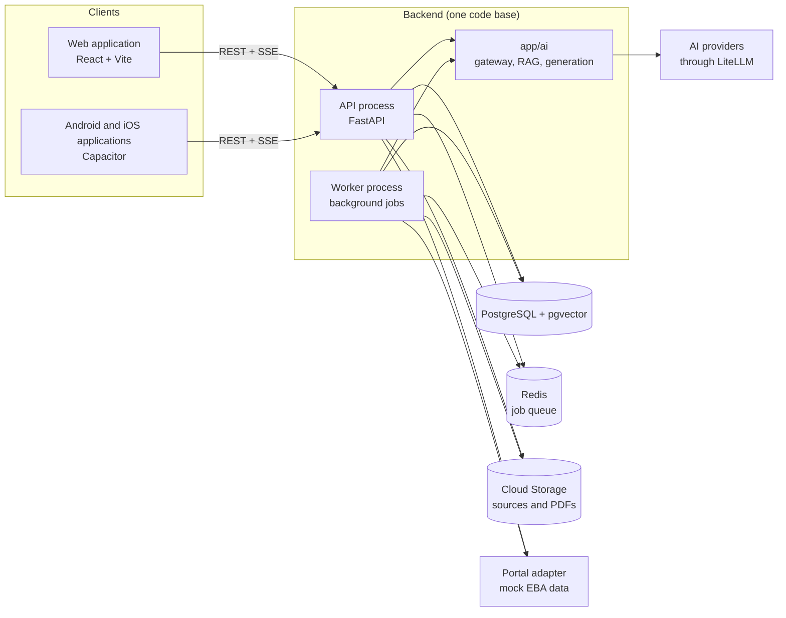
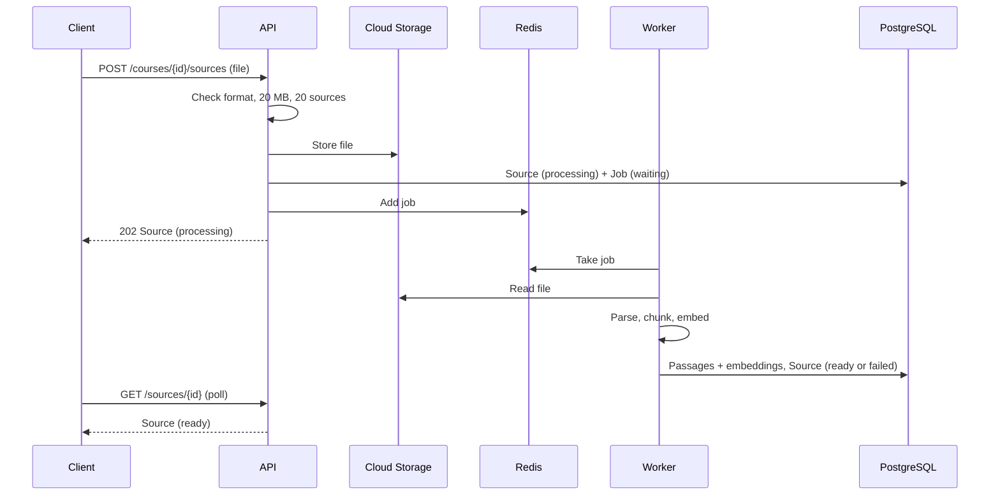
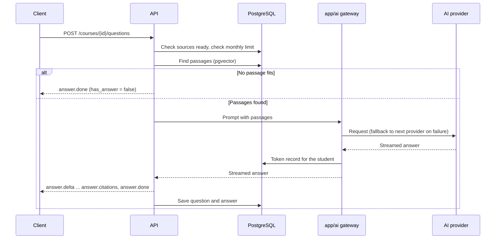

# Architecture and API Contracts (WBS-1.1)

This note gives the services, the data flow and the API rules of Chiron.
The API contract is in [`contracts/openapi.yaml`](../../contracts/openapi.yaml).
All build activities start from this note and the contract.

Sources: Project Charter, Project Plan v1.1 (sections 1.4, 2 and D-01 to D-08), Requirements Specification v1.0, `AGENTS.md` section 2.

## 1. Components

| Component | Responsibility | Requirements |
|---|---|---|
| Web application | Turkish interface for the three roles. Desktop and phone layouts. | FR-06, NFR-11, NFR-13 |
| Android and iOS applications | The web application packaged with Capacitor. Same API and accounts. | FR-38 to FR-41, NFR-16 |
| API process | REST endpoints. Checks the token, the role and the assignments on every call. Streams answers. | NFR-03, NFR-26 |
| Worker process | Source processing, summary and quiz jobs, portal imports, the weekly planning run. | FR-01, FR-16, FR-30 |
| `app/ai` | LLM gateway (fallback, token records, monthly limit), retrieval, generation. The API process and the worker process both use it. | FR-35 to FR-37 |
| PostgreSQL + pgvector | All data and the passage embeddings. | WBS-1.2 |
| Redis | Job queue between the API process and the worker process. | WBS-1.7 |
| Cloud Storage | Uploaded files and summary PDFs. | WBS-4.3, WBS-5.3 |
| Portal adapter | Reads accounts, assignments, courses, topics and grades. The mock adapter reads the mock EBA data. A real adapter can replace it. | FR-10 to FR-12 |

The API process and the worker process run from the same code base as two processes (`AGENTS.md` section 2).

## 2. Main data flows

### 2.1 Upload a source (UC-04)

### 2.2 Ask a question (UC-05, UC-11)

### 2.3 Summary and quiz (UC-06, UC-07)

1. The client sends `POST /courses/{id}/summaries` or `POST /courses/{id}/quizzes`.
2. The API checks the sources and the monthly limit. It creates the job and returns `202`.
3. The worker takes the job. It calls the gateway. For a summary, it compiles the LaTeX output to a PDF and stores it in Cloud Storage.
4. The client polls `GET /jobs/{id}`.
5. If the job fails or runs longer than 2 minutes, the job becomes `failed` with a message (NFR-18). The student can send `POST /jobs/{id}/retry` (FR-25).

### 2.4 Weekly planning run (UC-12)

1. A scheduled trigger adds the weekly planning job on Monday morning (FR-30).
2. The worker reads the latest grades from the portal adapter (FR-11).
3. The worker computes the success rates and finds the weak topics with the FR-28 rules.
4. The worker asks the gateway for the study steps of each weak topic.
5. The worker saves the plans. Students read them with `GET /study-plans/current`.

The study planner design (WBS-6.1) gives the details.

## 3. Authentication and sessions

Decision by Burak (16.11.2026), open for team review: access token and refresh token.

- `POST /auth/activate` and `POST /auth/login` return a token pair.
- The access token is a JWT with a lifetime of 15 minutes. It holds the user ID and the role.
- The refresh token is a random value. The database keeps only its hash. The client sends it to `POST /auth/refresh` and gets a new pair. The old refresh token stops working (rotation).
- `POST /auth/logout` revokes the refresh token (FR-04). It needs only the refresh token, so a client can log out also after the access token expired. The access token stops working at the end of its lifetime.
- Where the web application keeps the tokens is an open point (see section 6). The mobile applications keep the refresh token in the secure storage of the phone (FR-40).
- Activation and login use two endpoints. There is no endpoint that tells whether a portal ID exists or is active (FR-05).
- Passwords are stored only as salted hashes (NFR-01).

The access and privacy design (WBS-2.1) gives the access matrix and the KVKK data list.

## 4. API rules

- **Contract first.** Change `contracts/openapi.yaml` before you change an endpoint (`AGENTS.md` section 2).
- **Prefix.** All endpoints start with `/api/v1`, except `/health`.
- **Authorization.** All endpoints need `Authorization: Bearer <access token>`, except `/health`, activate, login, refresh and logout. The API checks the role and the assignments on every call (NFR-03). Hiding a page in the client is not an access control.
- **Roles and access.** Each operation in the contract has `x-roles` (the roles that can call it) and `x-access` (the data check after the role check: `self`, `own`, `assigned` or `none`). The authorization tests (WBS-2.2) and the pages use these fields. The contract description defines the values.
- **Errors.** All errors use `application/problem+json` (RFC 9457) with a stable `code` and a Turkish `detail` that the client can show.
- **IDs.** All IDs are UUIDs, except the `portal_id` from the portal data.
- **Times.** All times are in UTC (ISO 8601). The client shows them in Turkish time.
- **Long tasks.** Source processing, summaries, quizzes and imports return `202` with a job. The client polls `GET /jobs/{id}` (FR-01).
- **Answers.** `POST /courses/{id}/questions` returns a server-sent event stream (decision by Burak, 16.11.2026, open for team review), so that the answer starts to appear early (NFR-09). The browser `EventSource` API supports only `GET`, and the generated API client does not read streams. The frontend reads this stream with `fetch` and a stream reader.
- **Pages.** Lists that grow without a limit (the question history) use `limit` and `cursor`.

### 4.1 Assignments and dashboards

The three assignment lists are independent (FR-07, FR-08):

- A teacher sees the students that have this teacher in `student_teachers`, in the subject of the teacher.
- An administrator sees the students that have this administrator in `student_administrators`, in all subjects.
- An administrator manages the teachers that have this administrator in `teacher_administrators`.

After UC-02 A3, a student can have a teacher in the group of another administrator. Each dashboard still follows its own list: the teacher sees the student, and the student's administrator sees the student.
UC-02 E1 applies only when an administrator moves a student to a teacher: the teacher must be in the group of the administrator.

## 5. Requirement to endpoint map

| Requirement | Endpoints |
|---|---|
| FR-01 | `GET /jobs/{id}`; `202` responses of upload, summary, quiz and import |
| FR-02 | `POST /auth/activate` |
| FR-03, FR-05 | `POST /auth/login` |
| FR-04 | `POST /auth/logout`, `POST /auth/refresh` |
| FR-06 | `GET /me` (role); `403` on all endpoints |
| FR-07 | `GET /dashboard/students`, `GET /dashboard/students/{id}` |
| FR-08 | `PUT /admin/students/{id}/teacher`, `PUT /admin/students/{id}/administrator`, `PUT /admin/teachers/{id}/administrator` |
| FR-09 | `DELETE /admin/users/{id}` |
| FR-10 | `GET /courses`, `GET /courses/{id}` |
| FR-11 | `POST /auth/login` (reads grades), `GET /grades` |
| FR-12 | `POST /admin/imports` |
| FR-13 to FR-15 | `POST /courses/{id}/sources` |
| FR-16 | `GET /sources/{id}` (status) |
| FR-17 | `GET /courses/{id}/sources`, `DELETE /sources/{id}` |
| FR-18, FR-19 | `POST /courses/{id}/questions`, `GET /passages/{id}`, `GET /sources/{id}/file` |
| FR-20 | `GET /courses/{id}/questions` |
| FR-21 | `POST /courses/{id}/summaries`, `GET /summaries/{id}`, `GET /summaries/{id}/pdf` |
| FR-22 | `POST /courses/{id}/quizzes`, `GET /quizzes/{id}` |
| FR-23, FR-24 | `POST /quizzes/{id}/submission`, `GET /quizzes/{id}` |
| FR-25 | `POST /jobs/{id}/retry` |
| FR-26 | Not in the contract. It is optional scope (Could). |
| FR-27 to FR-31 | `GET /study-plans/current` |
| FR-32, FR-33 | `GET /dashboard/students` |
| FR-34 | `GET /dashboard/token-usage` |
| FR-35, FR-36 | No endpoint. Inside the gateway (`app/ai`). |
| FR-37 | `429 token_limit_reached` with `resets_at`; `GET /me/token-usage` |
| FR-38 to FR-41 | Same endpoints as the web application (NFR-26) |

## 6. Open points

The documents do not decide these points. The owner decides them in the given activity.

| Point | Proposal in this draft | Decides in |
|---|---|---|
| Account takeover at activation. With only the portal ID, a person who knows the portal ID of another user can activate that account first. | Add a second check, for example a one-time activation code for each user in the portal data. This changes FR-02, so the team must decide. | Team decision; WBS-2.1 (Burak), Requirements Analysis |
| Password rules (length and others) | Not set | WBS-2.1 (Burak) |
| Refresh token lifetime | Not set | WBS-2.1 (Burak) |
| Where the web application keeps the tokens | Not set. Browser storage is open to XSS. Compare it with an `httpOnly` cookie. | WBS-2.1 (Burak) |
| Reuse detection for refresh tokens: if a revoked refresh token is used again, revoke all tokens of the user (proposal by Metin) | Not set | WBS-2.1 (Burak) |
| Rate limit on login and activate (proposal by Metin) | Not set | WBS-2.1 (Burak) |
| CORS: allowed origins, including the Capacitor origins (for example `capacitor://localhost`) | Not set | WBS-2.1 (Burak), WBS-12.1 |
| Delete a user at once or as a job | At once (`204`) | WBS-2.1 (Burak) |
| Monthly token limit for each student | Not set | Design Specification (FR-37 note) |
| Where bge-m3 runs | Not set | WBS-4.1, WBS-9.1 |
| Redis on GCP (Memorystore or another service) | Not set | WBS-9.1 (Berkay) |
| Scheduler for the weekly planning run | Not set | WBS-1.7, WBS-6.1 |
| Flashcards (FR-26) | Not in the contract | Only if the must-have features are done |

## 7. Contract tests

`tests/backend/test_openapi_contract.py` checks that:

- the contract is a valid OpenAPI 3.1 document,
- all operation IDs are unique,
- all protected operations document `401`,
- only `/health`, activate, login, refresh and logout are public. A new public operation fails the test.
- all protected operations have `x-roles` and `x-access`, and document `403` when a role or data check can refuse the call,
- all error responses use `application/problem+json`,
- all paths use the `/api/v1` prefix,
- every route of the backend is in the contract.

The last check makes sure that the backend does not add an endpoint that is not in the contract.
