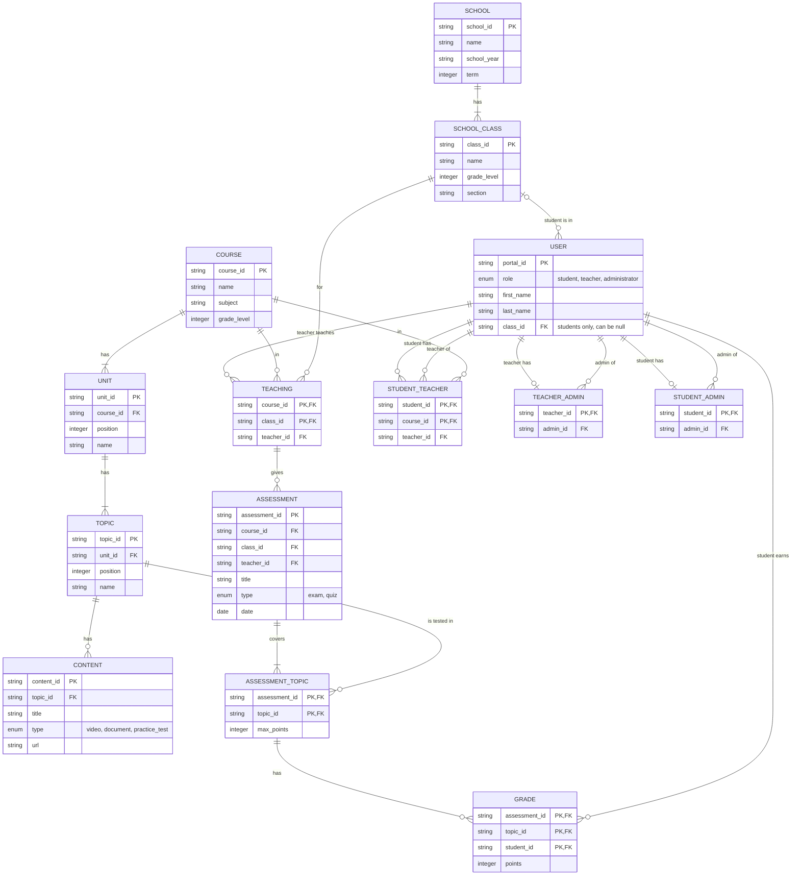

# Portal Data Design and Mock Data

| Field | Details |
|---|---|
| WBS activity | WBS-3.1 Portal data design and mock data (task T-03, issue #21) |
| Owner | Hasan Yalçın Arıkanoğlu |
| Reviewer | Abdullah Faruk Özbek |
| Used by | WBS-1.2 database design (Burak), WBS-3.2 adapter tests (Faruk), WBS-3.3 adapter (Berkay), WBS-6.1-6.3 study planner (Hasan, Burak, Faruk) |
| Status | Draft, 12.11.2026 |

## 1. Purpose

Chiron gets accounts, assignments, courses, topics and grades from the school portal (UT-04).
We do not connect to the real EBA platform. This is out of scope in the Project Plan.
A mock EBA adapter gives Chiron made-up portal data instead (T-03).

This note describes:

- the data that the portal gives to Chiron (Section 3),
- the rules for importing accounts and reading grades (Section 4),
- what the mock adapter returns (Section 5),
- the mock data files and how to create them again (Section 6),
- the cases in the data that the study planner tests need (Section 7).

The requirement IDs (FR, NFR, UC, UT, SC) come from the Requirements Specification (PR #7).
Some details are not in the Requirements Specification. This note marks them as **Proposal** and lists them in Section 9.

## 2. Overview of the mock data

The data shows one school on 12.11.2026, in the first term of the 2026-2027 school year.
At this date the classes had only their first quizzes and written exams.
For this reason, only 11 of the 42 topics have grades.

| Item | Count |
|---|---|
| Schools | 1 (Chiron Deneme Anadolu Lisesi) |
| Classes | 2 (10-A and 10-B) |
| Students | 30 (15 in each class), and 2 more in the later import |
| Teachers | 4 |
| Administrators | 2 |
| Courses | 3 (Kimya 10, Matematik 10, Fizik 10) |
| Units / topics / contents | 14 / 42 / 94 |
| Assessments | 14 (one quiz or written exam for each class) |
| Grade rows | 437 (318 student and topic pairs) |

The task asks for at least 2 classes, 3 teachers, 1 administrator and 30 students.
We added one teacher and one administrator for these reasons:

- There are two chemistry teachers under one administrator. An administrator can then move a student to another teacher of the same subject (FR-08, UC-02 main flow).
- There are two administrators. Tests can then check that an administrator sees only their own students (FR-07). Tests can also move a teacher to the other administrator (UC-02 A3) and try a teacher outside the group (UC-02 E1).

All names, IDs and grades are made up (NFR-05). Murat Ercan, Ayşe Tunç and Elif Aksoy are named after the personas P-02, P-03 and P-01, so that demos can follow the scenarios.
The course, unit and topic names follow the headings of the 10th-grade MEB curriculum.

## 3. Data model

The diagram shows the portal data as entities. Each JSON list in the mock data is one entity.
The diagram uses `SCHOOL_CLASS` because `CLASS` is a reserved word in Mermaid. The JSON list is `classes`.



General rules:

- The portal gives every ID. The IDs do not change. Chiron uses them to match records on later imports and grade reads.
- Types: `string`, `integer`, `date` (ISO 8601 text, `YYYY-MM-DD`) and `enum` (text with fixed values). `null` means "no value".
- The ID formats below are only for people who read the data. Code must use the fields (for example `role`), not the prefix of an ID.
- The mock data has one school. The classes do not have a `school_id` field for this reason.

### 3.1 School and classes (`school.json`)

| Entity | Field | Type | Key | Notes |
|---|---|---|---|---|
| school | `school_id` | string | PK | `OKUL-01` |
| school | `name` | string | | Turkish school name |
| school | `school_year` | string | | `2026-2027` |
| school | `term` | integer | | 1 or 2 |
| classes | `class_id` | string | PK | `10-A`, `10-B` |
| classes | `name` | string | | Name shown to users |
| classes | `grade_level` | integer | | 9-12 |
| classes | `section` | string | | `A`, `B` |

The file also has a `dataset` object with the generator name, the seed and the date of the data (`as_of`). Chiron does not import it.

Serves: FR-10, FR-27 (the class average needs the class of each student), UC-03, UC-10 (filter by class).

### 3.2 Users and roles (`users.json`)

| Field | Type | Key | Notes |
|---|---|---|---|
| `portal_id` | string | PK | Login ID. `OGR-1001`-`OGR-1032` students, `OGT-2001`-`OGT-2004` teachers, `YON-3001`-`YON-3002` administrators |
| `role` | enum | | `student`, `teacher` or `administrator`. One role for each user |
| `first_name` | string | | |
| `last_name` | string | | |
| `class_id` | string | FK to classes | Students only. `null` for teachers and administrators, and for a student who has no class yet |

The portal data has no passwords. The user sets a password at activation, and Chiron stores it as a salted hash (FR-02, NFR-01).
The portal data has no e-mail address, national ID number, birth date or phone number. Chiron does not need them (NFR-04).

Serves: FR-02, FR-03, FR-05, FR-06, FR-12, UC-01.

### 3.3 Courses, units, topics and content (`curriculum.json`)

| Entity | Field | Type | Key | Notes |
|---|---|---|---|---|
| courses | `course_id` | string | PK | `KIM10`, `MAT10`, `FIZ10` |
| courses | `name` | string | | `Kimya 10` |
| courses | `subject` | string | | `Kimya`. A teacher teaches one subject (UT-02) |
| courses | `grade_level` | integer | | 10 |
| units | `unit_id` | string | PK | `KIM10-U1` |
| units | `course_id` | string | FK to courses | |
| units | `position` | integer | | Order in the course, from 1 |
| units | `name` | string | | |
| topics | `topic_id` | string | PK | `KIM10-U1-T2` |
| topics | `unit_id` | string | FK to units | |
| topics | `position` | integer | | Order in the unit, from 1 |
| topics | `name` | string | | `Mol Kavramı` |
| contents | `content_id` | string | PK | `KIM10-U1-T2-C1` |
| contents | `topic_id` | string | FK to topics | |
| contents | `title` | string | | `Mol Kavramı - Konu Anlatımı` |
| contents | `type` | enum | | `video`, `document` or `practice_test` |
| contents | `url` | string | | Fake link on `portal.example`. It does not open a real page |

We use `position` and not `order`, because `ORDER` is a reserved word in SQL.

A class takes a course when a teaching assignment exists for the class and the course (Section 3.4).
Every topic has a video and a document. The topics of the first unit of each course also have a practice test.

Content is in the scope of T-03 ("courses, units, topics, content"). No functional requirement uses content yet. The study plan design (WBS-6.1) can link plan steps to it.
Chiron does not download content files. Content is not a student source (FR-13).

Serves: FR-10, UC-03, and the topic IDs used by FR-22 (quiz topics), FR-27 and FR-28.

### 3.4 Assignments (`assignments.json`)

The portal gives four kinds of assignments.

| List | Fields (key in bold) | Meaning | Count |
|---|---|---|---|
| `teaching` | **`course_id`, `class_id`**, `teacher_id` | The teacher teaches the course to the class. One teacher for each course in a class | 6 |
| `student_teacher` | **`student_id`, `course_id`**, `teacher_id` | The student is assigned to the teacher for the course | 90 |
| `teacher_admin` | **`teacher_id`**, `admin_id` | The teacher is assigned to the administrator | 4 |
| `student_admin` | **`student_id`**, `admin_id` | The student is assigned to the administrator | 30 |

At setup, `student_teacher` is the same as `teaching` for each student of the class.
We still store it as its own list, because an administrator can move one student to another teacher (FR-08). After that move, the two lists are different.

Assignments in the mock data:

| Teacher | Subject | Classes | Administrator |
|---|---|---|---|
| OGT-2001 Murat Ercan | Kimya | 10-A | YON-3001 Ayşe Tunç |
| OGT-2002 Gülşen Tekin | Kimya | 10-B | YON-3001 Ayşe Tunç |
| OGT-2003 Hakan Özer | Matematik | 10-A, 10-B | YON-3002 Kemal Ersoy |
| OGT-2004 Nurcan Bulut | Fizik | 10-A, 10-B | YON-3001 Ayşe Tunç |

The students of 10-A are assigned to YON-3001. The students of 10-B are assigned to YON-3002.

Rules:

- A teacher sees only the students in `student_teacher` with that teacher, and only in that course (FR-07, FR-32, UC-09).
- An administrator sees only the students in `student_admin` with that administrator, in all subjects (FR-07, FR-33, UC-10).
- An administrator manages the teachers in `teacher_admin` with that administrator. The administrator moves students between these teachers (FR-08, UC-02).

Serves: FR-07, FR-08, FR-12, FR-32, FR-33, NFR-03, UC-02, UC-09, UC-10.

### 3.5 Assessments and per-topic grades (`grades.json`)

An assessment is a quiz or a written exam of one course in one class. It covers one or more topics. Each topic has a maximum number of points in the assessment.
A grade is the points that one student earned in one topic of one assessment.

| Entity | Field | Type | Key | Notes |
|---|---|---|---|---|
| assessments | `assessment_id` | string | PK | `KIM10-10A-Y1` (course, class, assessment code) |
| assessments | `course_id` | string | FK to courses | |
| assessments | `class_id` | string | FK to classes | |
| assessments | `teacher_id` | string | FK to users | The teacher in `teaching` for the course and class |
| assessments | `title` | string | | `1. Yazılı Sınav`, `1. Kısa Sınav` |
| assessments | `type` | enum | | `exam` or `quiz` |
| assessments | `date` | date | | |
| assessments | `topics` | list | | Nested list of `topic_id` and `max_points` (the ASSESSMENT_TOPIC entity) |
| grades | `assessment_id` | string | PK, FK | |
| grades | `student_id` | string | PK, FK | |
| grades | `topic_id` | string | PK, FK | Must be one of the topics of the assessment |
| grades | `points` | integer | | 0 to `max_points` |

A missing grade row means that the student has no grade for that topic in that assessment. For example, the student was absent, or the teacher has not entered the grade yet.

**Proposal (for WBS-6.1):** the success rate of a student in a topic is the points earned divided by the points possible, over all assessments of the topic:

```
success rate (%) = 100 x SUM(points) / SUM(max_points)
```

Compute it in this order (multiply first) or with decimal numbers. With floating-point numbers, 0.6 x 100 is not exactly 60, and a 60% case can become weak by mistake. The mock data has such a case (Section 7).
The class average of a topic is the mean of the success rates of the students of the class who have grades in the topic (FR-27).
The check script in Section 7 uses these definitions. If WBS-6.1 changes them, run the check again.

Serves: FR-11, FR-27, FR-28, FR-29, FR-30, FR-31, FR-32, FR-33, UC-08, UC-12.

## 4. Importing accounts and reading grades

These rules come from FR-02, FR-08, FR-11, FR-12 and the functional requirement notes of the Requirements Specification.

1. **No sign-up.** All accounts come from the portal. In the Project Plan, "register" (T-02, WBS-2.3, WBS-2.4) means activation of an account that the portal already has.
2. **Setup import (FR-12).** When Chiron is set up for a school, Chiron imports all users and all assignments from the portal. The accounts are not active yet.
3. **Activation (FR-02, UC-01).** At the first login, the user enters their portal ID and sets a password. A portal ID that is not in the imported accounts gets the general login error (FR-05).
4. **Later imports (FR-12, UC-02 A2).** An administrator starts a later import. Chiron adds only the users whose portal ID is new, with their assignments. Chiron does not change the assignments of users that it already has, even when the portal shows other assignments for them. Chiron does not delete users who are not in the portal any more.
5. **Administrator changes take precedence (FR-08).** After setup, administrators keep the assignments up to date in Chiron. A later import does not undo their changes.
6. **Grades (FR-11).** Chiron reads the grades of a student from the portal when the student logs in (UC-01 step 4). Chiron reads the grades of all students before every weekly planning run (UC-12 step 2). Each read replaces the stored grades of the student with the grades from the portal. Chiron does not change grades itself.
7. **Read time.** Chiron stores the time of the last successful grade read for each student. If the portal is not reachable, Chiron keeps the last grades and shows that time (UC-01 E3, UC-12 A1).
8. **Dashboards.** Teachers and administrators see the stored grades (FR-32, FR-33). The weekly run reads the grades of all students, so the grades are at most one week old, also for students who do not log in.

**Proposal:** Chiron imports the courses, units, topics and contents at setup, and adds new ones at later imports, like accounts. The Requirements Specification does not say when Chiron reads them (FR-10). See Section 9.

## 5. What the mock adapter returns

The adapter is a Python interface in the backend (WBS-3.3). It is not a REST endpoint, so `contracts/openapi.yaml` does not change.
A real portal adapter can replace the mock adapter. The rest of the backend must use only the interface.

**Proposal:** the adapter has these operations. Berkay can change the names in WBS-3.3.

| Operation | Returns | Used by |
|---|---|---|
| `get_school()` | School and classes | Setup import; FR-10, UC-10 |
| `list_users()` | All users with role and class | Setup and later imports; FR-12, FR-02, UC-01, UC-02 A2 |
| `list_assignments()` | The four assignment lists | Setup and later imports; FR-12, FR-07 |
| `get_curriculum()` | Courses, units, topics and contents | FR-10, UC-03 |
| `get_student_grades(student_id)` | Assessments and grade rows of one student | Login; FR-11, UC-01 step 4 |
| `get_class_grades(class_id)` | Assessments and grade rows of all students of a class | Weekly run and class averages; FR-11, FR-27, FR-30, UC-12 step 2 |

If the portal is not reachable, every operation raises one error type, for example `PortalUnavailableError` (UC-01 E3, UC-12 A1).

The mock adapter reads the JSON files of Section 6. It has two settings for tests:

- **Snapshot.** `setup` returns the base files. `updated` returns the base files with `term_update.json` applied. A test switches from `setup` to `updated` to run a later import (FR-12) or to change a grade (FR-11).
- **Unavailable.** When this setting is on, every operation raises the "portal not reachable" error.

To apply `term_update.json`:

| List in `term_update.json` | How to apply it |
|---|---|
| `users_added` | Add to the users |
| `student_teacher` | Replace the row with the same `student_id` and `course_id`, or add it |
| `student_admin` | Add to `student_admin` |
| `assessments_added`, `grades_added` | Add to the assessments and the grades |
| `grades_changed` | Replace `points` of the grade row with the same key |

## 6. Mock data files

**Folder:** `backend/app/services/portal/mock_data/`. Berkay must confirm this folder (see Section 9). The backend scaffolding has no portal adapter folder yet.

| File | Content |
|---|---|
| `school.json` | Dataset information, school, classes |
| `users.json` | 36 users: 30 students, 4 teachers, 2 administrators |
| `curriculum.json` | 3 courses, 14 units, 42 topics, 94 contents |
| `assignments.json` | 6 teaching, 90 student-teacher, 4 teacher-administrator and 30 student-administrator assignments |
| `grades.json` | 14 assessments and 437 grade rows |
| `term_update.json` | What the portal shows after setup: 2 new students with their assignments, 1 changed assignment of an existing student, 1 new quiz with 15 grades, 1 corrected grade |
| `generate_mock_data.py` | The generator of all JSON files |

Each JSON file is one object of lists. Each list item is on its own line, so the files are easy to read and to compare in a PR.

**Create the files again** (from the `backend` folder):

```
uv run python -m app.services.portal.mock_data.generate_mock_data
```

The generator uses a fixed seed (411), so every run writes the same files.
Do not edit the JSON files by hand. Change the generator and run it again. The test `test_files_match_the_generator` fails when the files and the generator are different.

How the generator works:

1. It writes the school, users, curriculum and assignments from fixed tables.
2. It gives each class a mean success rate for each graded topic, and each student a random ability for each course. It then adds random noise for each topic.
3. It sets the planner test cases of Section 7 to fixed values (the `DESIGNED` table).
4. It moves grades by one point until no success rate is within 2 points of 60%, and no class gap is within 2 points of 15. It also keeps every success rate at least 1 point away from 30%, 40% and 50% (the study-hour bands of FR-29). The weak-topic result then does not depend on rounding. The 60% boundary case is the only exception.

## 7. Test cases for the study planner

Rule from FR-28: a topic is weak when the success rate is below 60%, or when it is at least 15 points below the class average for the topic. The class average is only used when at least 5 students of the class have grades in the topic.
Study hours from the FR-29 note: 50-59% gives 1 hour, 40-49% 2 hours, 30-39% 3 hours and below 30% 4 hours. A topic that is weak only because of the class average gets 1 hour.

### 7.1 Cases set by hand

The class average includes the student. Numbers are rounded to one decimal.

| Student | Class | Topic | Success rate | Class average | Graded students | Expected result |
|---|---|---|---|---|---|---|
| OGR-1001 Elif Aksoy | 10-A | KIM10-U1-T2 Mol Kavramı | 45.0 | 73.5 | 15 | Weak, below 60%, 2 hours |
| OGR-1001 Elif Aksoy | 10-A | KIM10-U1-T4 Kimyasal Tepkimelerde Hesaplamalar | 56.0 | 62.1 | 15 | Weak, below 60%, 1 hour |
| OGR-1001 Elif Aksoy | 10-A | KIM10-U1-T1 Kimyanın Temel Kanunları | 70.0 | 88.5 | 15 | Weak by the class rule, 1 hour |
| OGR-1004 Yusuf Korkmaz | 10-A | FIZ10-U1-T2 Elektrik Devreleri | 35.0 | 68.0 | 15 | Weak, 3 hours |
| OGR-1004 Yusuf Korkmaz | 10-A | MAT10-U1-T2 Basit Olayların Olasılıkları | 26.7 | 69.6 | 15 | Weak, 4 hours |
| OGR-1007 Nisa Doğan | 10-A | KIM10-U1-T4 Kimyasal Tepkimelerde Hesaplamalar | 60.0 | 62.1 | 15 | Not weak (boundary: exactly 60%) |
| OGR-1009 Kerem Karaca | 10-A | MAT10-U2-T1 Fonksiyon Kavramı ve Gösterimi | 66.7 | 87.6 | 15 | Weak by the class rule, 1 hour |
| OGR-1016 Deniz Şahin | 10-B | KIM10-U1-T1 Kimyanın Temel Kanunları | 47.5 | 77.5 | 15 | Weak, 2 hours. After `term_update.json`: 67.5, not weak |
| OGR-1016 Deniz Şahin | 10-B | KIM10-U1-T2 Mol Kavramı | 37.5 | 66.5 | 15 | Weak, 3 hours |
| OGR-1020 Ecrin Demir | 10-B | FIZ10-U1-T3 Mıknatıs ve Manyetik Alan | 65.0 | 83.3 | 15 | Weak by the class rule, 1 hour |
| OGR-1029 Onur Kaya | 10-B | MAT10-U1-T1 Sıralama ve Seçme | 28.3 | 68.6 | 15 | Weak, 4 hours |
| OGR-1027 Arda Çetin | 10-B | KIM10-U2-T1 Homojen ve Heterojen Karışımlar | 70.0 | 87.5 | 4 | Not weak. The gap is 17.5 points, but only 4 students have grades, so the class rule cannot apply |
| OGR-1011 Alp Avcı | 10-A | All topics | | | | No weak topic (UC-08 A1) |

Notes on the cases:

- **Elif (SC-04).** She has exactly three weak topics: two below 60%, and one at 70% with a class average of about 88%. This matches scenario SC-04. It is also close to the acceptance scenario of UC-08.
- **Fewer than 5 graded students.** In 10-B, the teacher has entered only 4 grades of the quiz `KIM10-10B-KS2` so far. In 10-A the same topic has 14 graded students. This shows that the rule works for each class.
- **Absent students.** OGR-1012 has no grade in `FIZ10-10A-KS1`, but has a grade in the same topic in the written exam. OGR-1013 has no grade in `KIM10-10A-KS2`, so he has no success rate in that topic. A topic without a success rate is not weak.
- **No grades (UC-08 E1).** The two new students in `term_update.json` have no grades.
- **No class (UC-03 A1).** The new student OGR-1032 has no class yet, so she has no courses.

### 7.2 Cases from the random grades

The random grades add more cases, as in a real class:

- 36 student and topic pairs are below 60%, in all four hour bands. The topic `KIM10-U1-T4` is hard for 10-A: 7 of 15 students are below 60%. A teacher dashboard shows this (SC-05).
- 6 pairs are weak only by the class rule.
- 21 of the 30 students have at least one weak topic. 9 students have none.

### 7.3 Later import cases

`term_update.json` has these cases:

| Case | Data | Expected result | Requirement |
|---|---|---|---|
| New student in a class | OGR-1031 Ömer Yıldız, 10-A, with three teachers and administrator YON-3001 | Added by the later import. Can activate the account | FR-12, UC-02 A2, UC-01 |
| New student without a class | OGR-1032 Duru Sarı, no class, administrator YON-3002 | Added. Sees "no courses yet" | FR-12, UC-03 A1 |
| Portal moves an existing student | OGR-1005 Kimya teacher becomes OGT-2002 in the portal | The later import ignores it. OGR-1005 stays with OGT-2001, or with the teacher an administrator chose | FR-12, FR-08 |
| Corrected grade | OGR-1016, `KIM10-10B-Y1`, `KIM10-U1-T1`: 12 points become 20 | Shows after the next login and in the next weekly plan. The topic is not weak any more | FR-11 |
| New quiz | `FIZ10-10A-KS2` on 18.11.2026, topic `FIZ10-U1-T4`, 15 grades | Read before the next weekly run. 2 new weak pairs (OGR-1003, OGR-1008) | FR-11, FR-30 |

### 7.4 Class average with or without the student

FR-28 says "at least 5 students of the class have grades". We read this as: the count and the class average include the student.
Another reading is "5 classmates", without the student. The mock data gives the same weak topics with both readings, and no class has exactly 5 graded students in a topic.
The planner tests (WBS-6.2) need their own small cases for the exact boundary of 5 students and of a 15-point gap.

### 7.5 Check script

The file `tests/backend/test_portal_mock_data.py` checks the data. It has its own copy of the FR-28 rule, so it does not depend on the planner code. CI runs it with the other backend tests.

It checks that:

- the data has at least 2 classes, 3 teachers, 1 administrator and 30 students,
- every ID that a record refers to exists, before and after `term_update.json`,
- each teacher teaches one subject, and each student has a teacher for every course of the class,
- topics below 60% exist in all four hour bands,
- topics exist that are weak only by the class rule,
- a topic exists with fewer than 5 graded students, with a student who would be weak if the class rule applied,
- exactly 60% is not weak,
- at least one student has no weak topic,
- both readings of Section 7.4 give the same result,
- Elif matches SC-04,
- `term_update.json` has the later import cases of Section 7.3,
- the JSON files are the same as the generator output.

Run the tests, or print a report of all cases (from the `backend` folder):

```
uv run pytest -k portal
uv run python ../tests/backend/test_portal_mock_data.py
```

## 8. Requirements traceability

| Part of the design | Requirements and use cases |
|---|---|
| Users, roles, no sign-up, activation | FR-02, FR-03, FR-05, FR-06, NFR-01, UC-01 |
| Setup and later imports | FR-12, FR-08, UC-02 A2 |
| Assignments | FR-07, FR-08, FR-32, FR-33, NFR-03, UC-02, UC-09, UC-10 |
| Courses, units, topics, content | FR-10, UC-03; T-03 scope for content |
| Grades, read times, portal not reachable | FR-11, FR-30, UC-01 E3, UC-12 A1 |
| Success rate and class average | FR-27, FR-31 |
| Weak-topic cases and study hours | FR-28, FR-29, UC-08, UC-12, SC-04 |
| No personal data beyond names, fake data only | NFR-04, NFR-05 |
| Mock adapter as a replaceable interface | T-03, UT-04, WBS-3.3 |

## 9. Open questions

| # | Question | For | Proposal in this note |
|---|---|---|---|
| 1 | Is `backend/app/services/portal/mock_data/` the right folder for the data and the generator? The generator is then part of the backend package. | Berkay | Keep it there. The adapter goes in `backend/app/services/portal/` |
| 2 | Does a student have exactly one administrator? Does a teacher have exactly one administrator? The Requirements Specification does not say. | Hasan, Burak | One administrator each (`student_admin` and `teacher_admin` have the student or the teacher as the key) |
| 3 | UC-02 A3 moves a teacher to another administrator "with the teacher's students". A student has teachers in several subjects. Which administrator does the student get? | Hasan | Move only the teacher. Change `student_admin` in a separate step |
| 4 | When does Chiron read courses, units and topics? FR-10 does not say. | Burak, Berkay | At setup, and add new ones at later imports (Section 4) |
| 5 | An administrator deletes an account (FR-09), but the student is still in the portal. A later import adds the student again as a new account. Is this right? A list of deleted portal IDs stops this, but it keeps personal data (NFR-04, NFR-06). | Hasan, Burak | Accept it, and write it in the access and privacy design (WBS-2.1) |
| 6 | Chiron's tables need fields that the portal does not have: account status, password hash, activation time, last grade read time. | Burak | Add them in WBS-1.2. They are not portal data |
| 7 | Does Chiron store each grade row, or only the success rate of each topic? | Burak | Store the grade rows. The success rate is then a SQL query (WBS-6.3) and stays correct after a corrected grade |
| 8 | Is the success rate a weighted rate (Section 3.5)? How are rates like 49.6% put into the hour bands? | Hasan, Burak (WBS-6.1) | Weighted rate. The data has no rate within 1 point of a band edge, so it works with any rounding |
| 9 | Is the class average "with the student" or "without the student" (Section 7.4)? | Hasan | With the student, as the Requirements Specification says |
